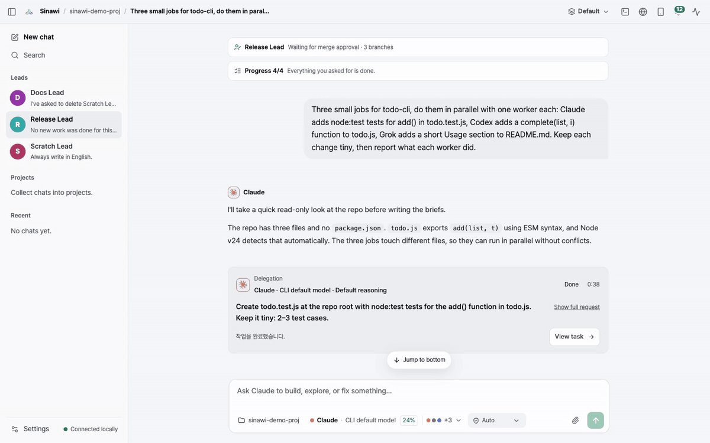
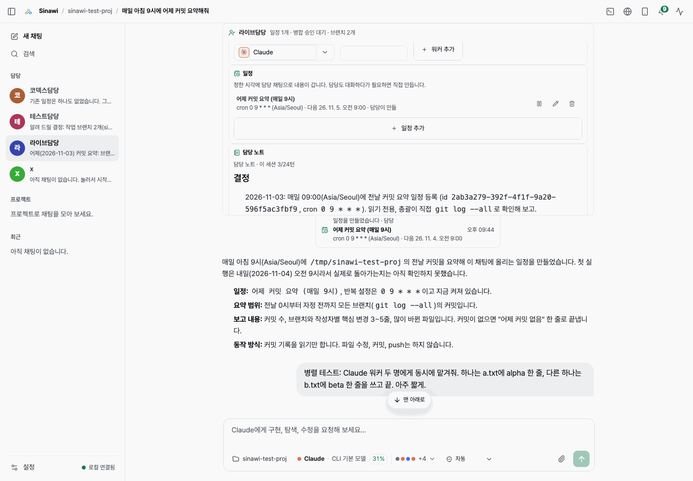
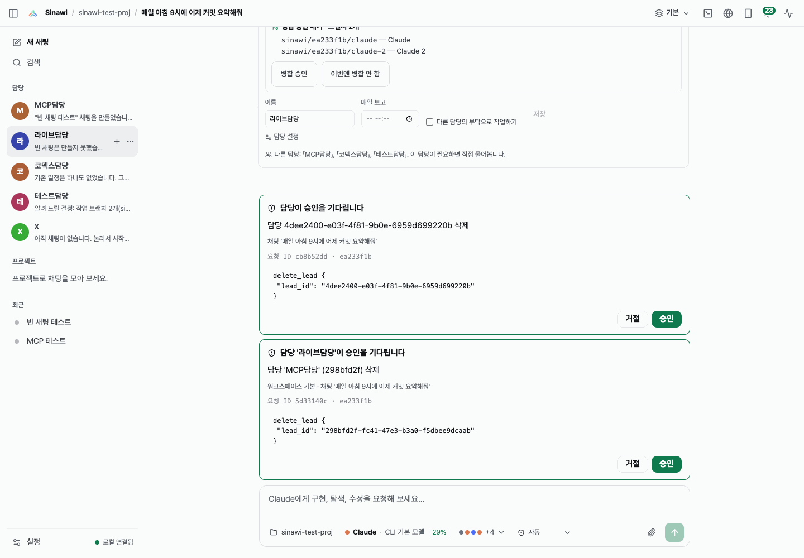
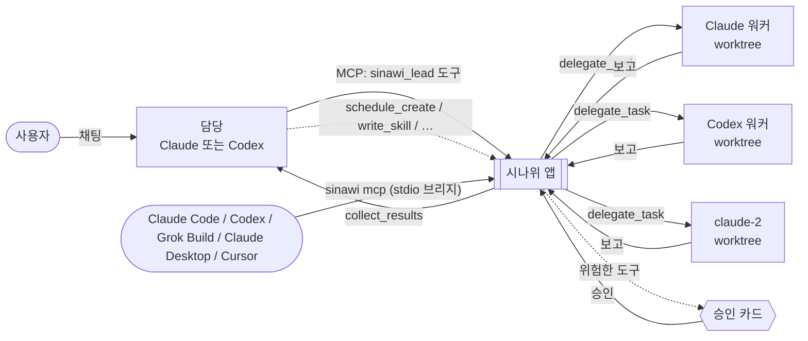

<div align="center">


# 시나위 (Sinawi)

**내 AI가 Claude Code · Codex · Grok에게 코딩 일을 맡기면, 그 대화를 시나위에서 실시간으로 보고 끼어듭니다.**

Mac 앱이자 MCP 서버입니다. Claude Code, Codex, Grok Build, Claude Desktop, Cursor 같은 MCP 클라이언트가 시나위에 채팅을 열고, 그 채팅은 직접 읽고 말을 이어 갈 수 있는 평범한 채팅입니다. 프로젝트 담당과 직접 채팅할 수도 있습니다.

[](https://github.com/Rakmlabs/sinawi/releases/latest) [](https://github.com/Rakmlabs/sinawi/releases) [](#설치) [](docs/mcp.ko.md) [](LICENSE) [](https://github.com/Rakmlabs/sinawi/stargazers)

[English](README.md) · **한국어**

[다운로드](https://github.com/Rakmlabs/sinawi/releases/latest) · [내 AI 연결하기](#내-ai-연결하기-mcp) · [동작 방식](#동작-방식) · [MCP](docs/mcp.ko.md) · [AI에게 붙여넣는 프롬프트](#ai에게-붙여넣는-프롬프트) · [AI 에이전트용](#ai-에이전트용-문서) · [협업 문의](#만든-곳-rakm)

<br />



<sub>담당이 Claude 워커 두 명에게 동시에 일을 맡기고, 두 worktree를 확인한 뒤 커밋을 보고했습니다.</sub>

</div>

---

## 어디에 쓰나

가장 결과가 좋았던 방식은 코딩 에이전트 하나가 아니었습니다. **총괄 AI 하나가 프롬프트와 스킬을 쓰고 Claude, Codex에게 일을 나눠 주는 방식**이었습니다. 그런데 AI가 MCP로 다른 AI를 부리면 총괄은 결과만 받고, 그 사이의 대화는 사람이 볼 수 없습니다. 시나위는 그 일을 화면의 채팅으로 열어서, 보고, 끼어들고, 위험한 동작은 승인할 수 있게 합니다.

이런 상황에 쓰입니다.

- **Claude Desktop이나 Cursor를 지휘자로 쓸 때.** 이들은 직접 코드를 고치지 못합니다. 시나위의 `create_session`으로 Claude Code나 Codex에 일을 열면 실제 작업 대화는 시나위 채팅으로 흐르고, 거기서 "그 파일 말고 저 파일"이라고 바로 끼어들 수 있습니다.
- **CLI 하나(Claude Code, Codex, Grok Build)를 총괄로 두고 다른 CLI에 일을 시킬 때.** 그냥 MCP로 부르면 하위 에이전트의 대화가 보이지 않습니다. 시나위에서는 작업마다 이름 붙은 채팅으로 남아 나중에 다시 읽을 수 있습니다(총괄도 `get_session`으로 읽습니다).
- **같은 일을 여러 모델에 시켜 보고 고를 때.** 총괄이 Claude, Codex, Grok에 채팅을 하나씩 열고, 사람은 세 대화를 나란히 보며 방향이 틀어진 쪽만 바로잡습니다.

이름은 정해진 악보 없이 즉흥으로 합을 맞추는 우리 음악 *시나위*에서 따왔습니다.

## 핵심 기능

<table>
<tr>
<td width="50%" valign="top">

### 🔌 내 AI가 시나위에 일을 맡기고, 나는 봅니다
바깥 AI가 `list_leads`로 담당을 찾고 `create_session`을 부르면, 그 담당의 새 채팅이 탭으로 열리고 AI가 고른 에이전트·모델로 일을 시작합니다. `wait_for_session`은 끝날 때까지 기다렸다가 새 메시지를 돌려주고, `send_message`로 이어 시키고, `show_session`으로 앱에 그 채팅을 띄웁니다. 바깥 AI가 보낸 메시지에는 *Grok Build가 MCP로 보냄* 같은 배지가, 탭에는 플러그 아이콘이 붙습니다. 같은 채팅에 내가 직접 말해도 됩니다.

</td>
<td width="50%" valign="top">

### 💬 담당과 직접 채팅도
**담당**은 프로젝트 하나를 맡습니다. 담당마다 채팅이 여러 개 있고 대화 위에 탭으로 보입니다. 폴더, 지침, 노트는 함께 쓰고 기록은 채팅마다 따로입니다. 일을 주면 요청을 쪼개고 구조화된 브리프(목표, 맥락, 완료 기준, 제약, 검증, 보고 형식)를 쓰고 맞는 스킬을 고릅니다.

</td>
</tr>
<tr>
<td valign="top">

### ⚡ 병렬 워커
`delegate_task`, `check_task`, `collect_results`. 워커가 바쁘면 담당이 워커를 더 붙이고(`claude-2` 등), 각자 자기 git worktree에서 일합니다. 디자인 작업은 스크린샷과 함께 돌아옵니다.

</td>
<td valign="top">

### 🧠 if문이 아니라 AI가 판단합니다
앱의 모든 기능이 MCP 도구(**91개**)로 열려 있습니다. 담당이 대화를 보고 무엇을 부를지 정합니다. 스킬 작성, 채팅·공간·담당 생성, 일정 만들기까지.

</td>
</tr>
<tr>
<td valign="top">

### 🛡️ 위험한 작업은 승인 카드로
삭제, 설정 변경, 병합, 터미널 명령(도구 30개)은 앱에서 승인해야 실행됩니다. AI가 자기 요청을 스스로 승인하는 도구는 없습니다. 담당별 병합 정책은 `auto`, `ask`, `never`.

</td>
<td valign="top">

### 🗓️ 대화하다 생기는 일정
*"매일 아침 9시에 어제 커밋 요약해줘"*라고 하면 담당이 직접 cron 일정을 만듭니다. 한 번 또는 반복, Mac 시간대 기준, 담당 설정에서 관리합니다.

</td>
</tr>
</table>

<div align="center">


<br />
<sub>왼쪽: 담당이 스스로 만든 일정. 오른쪽: 담당 삭제는 승인을 기다립니다.</sub>
</div>

## 동작 방식



1. 평소처럼 담당과 채팅합니다.
2. 앱이 MCP로 담당에게 도구를 줍니다. 무엇을 쓸지는 담당이 정합니다.
3. 워커는 각자 worktree에서 병렬로 일하고, 시나위가 보고를 확인해 결과를 돌려줍니다.
4. 되돌릴 수 없는 작업은 승인 카드에서 멈추고 결정을 기다립니다.
5. 바깥 AI도 `sinawi` MCP 서버로 똑같이 씁니다. 바깥 AI가 연 채팅도 앱에 다른 채팅처럼 보입니다.

> [!NOTE]
> MCP 도구는 Claude, Codex 담당이 씁니다. **Grok 담당**은 실행마다 MCP를 붙이는 방법이 아직 없어서 텍스트 태그 방식으로 동작하고, 이 도구들은 쓸 수 없습니다. 이건 시나위 안의 담당 이야기입니다. Grok Build를 바깥 AI로 두고 MCP로 시나위에 붙이는 것은 다른 클라이언트처럼 됩니다.

## 공간

공간(workspace)은 앱 안의 따로 쓰는 책상입니다. **F1** / **F2**(첫째·둘째 공간)나 머리말에서 바꿉니다.

- **채팅, 프로젝트 그룹, 기본값이 따로**: 폴더, 팀, 허용 에이전트, 한도 자동 전환.
- **담당도 공간마다 따로.** 사이드바, 새 채팅의 담당 선택, `list_leads`에는 지금 공간의 담당만 나옵니다. 담당과 그 채팅은 한 공간에 있고, 하나를 옮기면 함께 옮겨집니다. 담당은 같은 공간의 담당에게만 물어봅니다.
- **공간마다 정책**(설정 › 작업 공간): 이미지·영상 생성, 컴퓨터 조작, 전체 권한, Grok MCP, 막을 MCP 도구.
- **공간마다 CLI 계정(선택).** 공간에 Claude Code, Codex, Grok Build 계정 폴더를 정하면 그 공간의 모든 실행(담당, 워커, 라우터)에 `CLAUDE_CONFIG_DIR`, `CODEX_HOME`, `GROK_HOME`이 그 폴더로 붙습니다. 한 공간은 회사 계정, 다른 공간은 개인 계정으로 쓸 수 있습니다. 폴더마다 로그인, 설정, 기록, 스킬이 따로 있고 한도도 계정별로 봅니다. 터미널에서 한 번 로그인합니다. 예: `CODEX_HOME=/Users/you/accounts/work-codex codex login`(정확한 명령은 설정에 나옵니다). 비우면 CLI 기본 로그인을 씁니다.

## 설치

**[최신 릴리즈](https://github.com/Rakmlabs/sinawi/releases/latest)**에서 `Sinawi_<버전>_universal.dmg`를 받아 열고 **Sinawi**를 **응용 프로그램**으로 끌어다 놓으세요.

- Developer ID로 서명되고 Apple 공증을 받아 Gatekeeper 경고 없이 열립니다.
- Apple Silicon과 Intel 모두 네이티브로 동작합니다.
- 이후에는 GitHub Releases에서 자동 업데이트됩니다(재시작 시점은 직접 고릅니다).

> [!NOTE]
> npm 패키지가 게시된 뒤에는: `npx @rakmlabs/sinawi`가 최신 릴리즈를 받아 `codesign`·`spctl`로 확인하고, 이미 있는 앱을 바꿀지 물은 뒤 엽니다(`--yes`, `--no-open`, `--help`). [`@rakmlabs/sinawi`](packages/sinawi)는 아직 npm에 없으니 지금은 DMG를 쓰세요.

### 요구 사항

- macOS
- [Node.js](https://nodejs.org) **24.22.1 이상 권장**(22.x는 2026-10-20 보안 릴리즈인 22.23.4 이상), 로그인 셸 `PATH`에 있어야 합니다. Apple Silicon에서는 arm64 Node를 쓰세요
- 다음 CLI 중 하나 이상 설치 및 로그인: [Codex CLI](https://github.com/openai/codex) · [Claude Code](https://docs.anthropic.com/en/docs/claude-code/setup) · [Grok Build](https://docs.x.ai/build/overview)

시나위는 로그인 셸의 `PATH`와 흔한 설치 위치에서 CLI를 찾습니다. 앱의 **설정 → 도움말 및 설정 도우미**에서 찾은 CLI와 로그인 방법을 볼 수 있습니다. API 키는 묻지도 저장하지도 않고, 각 CLI의 로그인을 그대로 씁니다.

## 내 AI 연결하기 (MCP)

어떤 MCP 클라이언트든 앱에 들어 있는 작은 stdio 브리지로 시나위에 일을 맡길 수 있습니다. 보통 흐름은 이렇습니다.

1. `list_leads`로 그 프로젝트의 담당을 찾습니다.
2. `create_session(lead_id, prompt, title, agent, model)`이 그 담당의 새 채팅(탭)을 열고, AI가 고른 에이전트·모델로 일을 시작합니다(비우면 담당 자신의 것).
3. `wait_for_session(session_id, after_event_id)`이 끝날 때까지 기다렸다가 새 메시지와 마지막 답을 돌려줍니다.
4. `send_message`로 같은 채팅에 이어 시키고, `show_session`으로 그 채팅을 봐 달라고 알립니다(보고 있던 화면은 빼앗지 않습니다).

이 채팅들은 시나위에서 실시간으로 보이고, 바깥 AI가 보낸 메시지에는 배지가 붙습니다. 같은 채팅에 직접 말해도 됩니다.

**설정 → 외부 AI 연결**에는 클라이언트별 탭(Claude Code, Codex, Grok Build, Claude Desktop, Cursor, 그 밖의 MCP)이 있고, 내 Mac의 정확한 경로가 채워진 명령을 복사할 수 있습니다. Claude Desktop과 Cursor는 버튼 하나로 연결됩니다. 같은 화면에서 바깥 AI의 프롬프트나 스킬에 넣을 **바깥 AI에게 줄 사용법**도 복사할 수 있습니다.

설치된 앱 기준 명령:

```sh
# Claude Code
claude mcp add sinawi --scope user -- node /Applications/Sinawi.app/Contents/Resources/sinawi-mcp.mjs
# Codex
codex mcp add sinawi -- node /Applications/Sinawi.app/Contents/Resources/sinawi-mcp.mjs
# Grok Build
grok mcp add sinawi -- node /Applications/Sinawi.app/Contents/Resources/sinawi-mcp.mjs
```

Claude Desktop, Cursor와 그 밖의 클라이언트:

```json
{
  "mcpServers": {
    "sinawi": {
      "command": "node",
      "args": ["/Applications/Sinawi.app/Contents/Resources/sinawi-mcp.mjs"]
    }
  }
}
```

클라이언트가 `node`를 못 찾으면 `which node`의 전체 경로를 쓰세요. 같은 Mac에서는 브리지가 토큰 파일(`~/Library/Application Support/dev.sinawi.app/.data/app-mcp-token`)을 알아서 읽으므로 구성에 비밀값이 들어가지 않습니다. `SINAWI_MCP_TOKEN`은 다른 환경의 클라이언트에만 씁니다. 저장소에서는 `npm run sinawi-mcp`가 같은 브리지를 실행합니다.

확인한 것: Claude Code와 Grok Build는 실제로 연결됐습니다(Grok은 도구 81개를 찾음). Codex는 구성 등록까지만 확인했고 핸드셰이크는 확인하지 않았습니다.

**클라우드 에이전트(Grok Bot, Codex dots)는 지금 붙지 않습니다.** 둘 다 자기 클라우드 컴퓨터에서 돌고, 시나위는 이 Mac 안에서 오는 연결만 받습니다. Grok Bot은 이 Mac의 CLI인 Grok Build와 다른 제품입니다. 확인한 것과 못 한 것은 [docs/mcp-clients.md](docs/mcp-clients.md) 6-1절과 설정의 같은 이름 탭에 있습니다.

> [!NOTE]
> npm 패키지가 게시된 뒤에는: `node …/sinawi-mcp.mjs` 대신 `npx -y @rakmlabs/sinawi mcp`를 쓸 수 있습니다.

조회와 생성은 바로 실행되고, 위험한 도구는 승인 카드를 기다립니다. 자세한 안내: [docs/mcp.ko.md](docs/mcp.ko.md) · 클라이언트별 안내: [docs/mcp-clients.md](docs/mcp-clients.md) · 도구 범위: [docs/mcp-coverage.md](docs/mcp-coverage.md)

## AI에게 붙여넣는 프롬프트

Claude Code, Codex처럼 Mac에서 명령을 실행할 수 있는 AI에 그대로 붙여 넣으세요.

**시나위 설치와 설정**

```text
시나위(Sinawi, https://github.com/Rakmlabs/sinawi)를 설치하고 설정하는 걸 도와줘. 내 AI가 MCP로 Claude Code, Codex, Grok Build CLI에 코딩 일을 맡기고, 나는 그 채팅을 실시간으로 보는 macOS 앱이야.

1. 앱을 설치해 줘. https://github.com/Rakmlabs/sinawi/releases/latest 에서 최신 Sinawi_<버전>_universal.dmg를 받아 열고 Sinawi를 응용 프로그램으로 옮겨 줘. 서명·공증된 앱이야. (npm 설치기 `npx @rakmlabs/sinawi`는 아직 게시되지 않았어.)
2. 로그인 셸 PATH의 Node.js를 확인해 줘(`node -v`). 24.22.1 이상을 권장하고, 22.x라면 22.23.4 이상이어야 해. Apple Silicon에서는 arm64 Node여야 해. 없거나 낮으면 설치해 줘(예: `brew install node`).
3. Git을 확인해 줘(`git --version`, 없으면 `xcode-select --install`).
4. 에이전트 CLI가 하나 이상 설치·로그인돼 있어야 해. 어떤 걸 쓸지 나에게 물어봐 줘:
   - Claude Code: `curl -fsSL https://claude.ai/install.sh | bash` 후 `claude auth login`
   - Codex CLI: `npm install -g @openai/codex` 후 `codex login`
   - Grok Build: `curl -fsSL https://x.ai/cli/install.sh | bash` 후 `grok login`
   로그인은 브라우저가 열리니 내가 직접 마칠게. 시나위는 API 키가 필요 없어.
5. 시나위를 터미널이 아니라 Finder나 Dock에서 열고, 설정 → 도움말 및 설정 도우미에서 Node, Git, CLI가 설치·로그인됨으로 보이는지 나에게 확인시켜 줘.
6. 못 찾는 게 있으면 `which` / `--version` 출력을 그대로 보여 주고 PATH를 고쳐 줘. ~/Library/Application Support/dev.sinawi.app 은 건드리지 마.
```

**내 AI를 MCP로 시나위에 연결**

```text
이 AI 클라이언트를 MCP로 시나위(https://github.com/Rakmlabs/sinawi)에 연결해 줘.

- 시나위가 /Applications에 설치돼 있고 이 Mac에서 켜져 있어야 해.
- 가장 쉬운 방법: 나에게 시나위 → 설정 → 외부 AI 연결에서 이 클라이언트의 탭을 골라 명령을 복사해 달라고 해 줘(정확한 경로가 채워져 있어). Claude Desktop이나 Cursor는 버튼 하나로 연결돼. 내가 클라이언트를 다시 시작하면 "확인"으로 넘어가.
- 아니면 브리지를 직접 등록해 줘:
  - Claude Code: `claude mcp add sinawi --scope user -- node /Applications/Sinawi.app/Contents/Resources/sinawi-mcp.mjs`
  - Codex: `codex mcp add sinawi -- node /Applications/Sinawi.app/Contents/Resources/sinawi-mcp.mjs`
  - Grok Build: `grok mcp add sinawi -- node /Applications/Sinawi.app/Contents/Resources/sinawi-mcp.mjs`
  - Claude Desktop, Cursor, 그 밖의 클라이언트: mcpServers에 "sinawi" 항목, command "node", args ["/Applications/Sinawi.app/Contents/Resources/sinawi-mcp.mjs"]. 클라이언트가 node를 못 찾으면 `which node`의 전체 경로를 써.
  이 Mac에서는 브리지가 시나위의 토큰 파일을 알아서 읽어. 나에게 토큰을 묻거나 구성에 넣지 마. (SINAWI_MCP_TOKEN은 다른 환경의 클라이언트에만 써.) 그다음 클라이언트를 다시 시작해 줘.
- 확인: `sinawi` 도구 목록을 보고 `app_status`를 호출해 봐.
- 일을 맡길 때: `list_leads` → `create_session(lead_id, prompt, title, agent, model)` → `wait_for_session(session_id, after_event_id)` → 이어 시킬 땐 `send_message` → 나에게 보여 줄 땐 `show_session`. 내가 같은 채팅에 직접 말했을 수 있으니 다음 지시 전에 새 메시지를 읽어.
- 위험한 도구(삭제, 설정 변경, 병합, 터미널 명령)는 `pending_approval`을 돌려줘. 승인·거절은 내가 시나위의 승인 카드에서 해. 네가 직접 승인하려고 하지 마.
- 참고: https://github.com/Rakmlabs/sinawi/blob/main/docs/ai/for-ai.ko.md
```

**코드베이스 이해·기여**

```text
시나위 코드베이스(https://github.com/Rakmlabs/sinawi)를 이해하고, 필요하면 기여하고 싶어.

1. 저장소를 클론하고 llms.txt, AGENTS.md, docs/ai/for-ai.ko.md, CONTRIBUTING.md 순서로 읽어 줘.
2. 구조를 요약해 줘: server/(Express + WebSocket 서버, CLI 실행, 오케스트레이션, server/app-tools.ts의 MCP 도구 목록), src/(React UI, 문구는 src/i18n.ts에 한국어·영어), src-tauri/(Tauri v2 셸), packages/sinawi/(`@rakmlabs/sinawi`: 앱 설치기와 MCP 브리지).
3. Node는 ^22.23.4, ^24.22.1, >=26.12.1 중 하나를 써. `npm install` 후 `npm run typecheck`, `npm test`, `npm run build`를 돌려 줘. 변경을 마치기 전에 셋 다 통과해야 해.
4. AGENTS.md 규칙을 지켜: 3001 포트와 실제 앱 데이터는 쓰지 말고, 개발 서버는 `SINAWI_PORT=3011 SINAWI_UI_PORT=5198 SINAWI_DATA_DIR="$(mktemp -d)" npm run dev`로 띄워. server/app-tools.ts를 바꾸면 `npm run docs:ai`를 돌려. UI 문구는 두 언어 모두 넣어.
5. 내가 말하기 전에는 커밋, 푸시, 풀 리퀘스트를 하지 마. 브랜치는 main에서(fix/… 또는 feat/…) 만들고 CONTRIBUTING.md대로 이슈를 연결해.
```

<details>
<summary><b>그 밖의 기능</b></summary>

- **담당과 워커.** 담당과 워커 조합을 직접 고르거나, *자동* 라우팅이 요청에 맞는 팀, 모델, 스킬을 고르게 할 수 있습니다. 브리프의 빠진 부분을 채우고, 요약 과정에서 사용자의 원래 말이 빠지지 않게 덧붙입니다. 한 워커의 브리프는 차례로, 여러 워커는 동시에 실행됩니다.
- **권한 모드**(Claude Code와 같은 방식): *계획*(읽기 전용, 담당이 제안한 계획을 한 번에 실행), *자동*(프로젝트 폴더 안에서 수정하고 일반 명령은 묻지 않음, Claude Code는 CLI 자체 auto 모드 사용), *전체 권한*(공간이 허용할 때만).
- **실시간 보기.** 메시지, 도구 호출, 명령, 파일 변경이 생기는 대로 보이고, CI나 배포를 기다리는 중인지도 표시됩니다.
- **공간.** 대화, 프로젝트, 담당, 기본값을 나눠 둡니다(F1 / F2). 공간마다 정책과 CLI 계정(선택)을 따로 정합니다. [공간](#공간) 참고.
- **사용량 대체.** CLI 하나의 사용량이 바닥나기 직전이면 다음으로 정해 둔 에이전트로 역할을 넘길 수 있습니다.
- **내장 브라우저와 컴퓨터 제어.** 에이전트가 앱의 브라우저를, macOS 권한을 주면 다른 앱도 조작합니다. 세션과 워커마다 탭이 따로 있고, 페이지는 공간을 넘나들지 않습니다.
- **Worktree, 터미널, 파일.** git worktree, 세션별 터미널, 이미지·PDF·Markdown 미리보기.
- **입력창.** `1. `, `- `, Shift+Enter로 마크다운 리스트가 이어지고, 한글 조합 입력도 처리합니다.
- **슬래시 메뉴.** `/clear`, `/compact`, `/usage`와 설치된 모든 스킬.
- **스킬.** `~/.claude/skills`, `~/.codex/skills`, `~/.codex/prompts`, `~/.grok/skills`, 프로젝트의 `./skills`를 읽습니다. 스킬이 없는 CLI의 워커에게는 지침을 첨부합니다.
- **봇.** 에이전트, 모델, 스킬, 지침을 프리셋으로 저장하고, 봇 둘이 정한 횟수만큼 대화하게 할 수 있습니다.
- **사용량과 업데이트.** 에이전트별 사용량 추적과 서명된 자동 업데이트.

</details>

<details>
<summary><b>소스에서 빌드</b></summary>

[Rust](https://rustup.rs)와 Xcode Command Line Tools(`xcode-select --install`)가 필요합니다.

```sh
git clone https://github.com/Rakmlabs/sinawi.git
cd sinawi
npm install
npm run app:build
```

앱은 `src-tauri/target/release/bundle/macos/Sinawi.app`에 만들어집니다. 직접 빌드한 앱은 공증되지 않고 서명된 업데이트도 받지 않습니다. `TAURI_SIGNING_PRIVATE_KEY`가 없으면 `npm run app:build`는 업데이터 파일만 건너뛰고 성공합니다.

npm 11은 설치 스크립트(`node-pty`, `esbuild`)에 대해 경고할 수 있습니다. `package.json`에 `allowScripts`가 선언돼 있고 서버가 `node-pty` 도우미의 권한을 직접 고치므로, 이 경고는 무시해도 됩니다.

개발:

```sh
npm run dev        # API 127.0.0.1:3001, 웹 UI http://127.0.0.1:5188
npm run app:dev    # Tauri 창에서 같은 환경
npm run typecheck && npm test && npm run build
```

`npm run dev`는 3001 포트를 쓰므로 설치된 시나위가 켜져 있으면 부딪힙니다. 나란히 띄우려면 일회용 데이터로 이렇게 실행하세요.

```sh
SINAWI_PORT=3011 SINAWI_UI_PORT=5198 SINAWI_DATA_DIR="$(mktemp -d)" npm run dev
```

두 서버 모두 `127.0.0.1`에만 열립니다. `SINAWI_PORT`, `SINAWI_DATA_DIR`로 API 포트와 데이터 폴더를 바꿀 수 있고, `SINAWI_UI_PORT`는 5188과 5198만 됩니다.

3001이 아닌 포트로 띄우면 **독립 실행**입니다. 설치된 앱과 같이 쓰는 `/tmp`의 브라우저·컴퓨터·serve 큐를 보지 않고, `~/.local/bin/ao-*`와 CLI 스킬 폴더를 고쳐 쓰지 않습니다(`SINAWI_ISOLATED=1`로 3001에서도 켜고, `=0`으로 끕니다).

**앱 창 키.** 사용자만 해야 하는 일(설정 변경, 승인, 병합, `/ws`, 터미널)은 Origin 머리말만으로는 허락되지 않고, 서버가 실행마다 새로 만들어 메모리에만 두는 키가 있어야 합니다. 이 키를 내주는 HTTP 경로는 없습니다.

- **설치된 앱:** 서버는 사용자만 들어갈 수 있는 폴더의 유닉스 소켓 `<데이터>/run/app-key.sock`으로만 키를 줍니다. 연결마다 앱 실행 파일을 `--sinawi-check-peer`로 실행해, 커널에 누가 연결했는지 묻고(`LOCAL_PEERTOKEN`) 그 프로세스가 실행 중인 코드를 앱 자신의 코드 서명과 대조합니다(Security 프레임워크). argv[0]·프로세스 이름·내세운 경로는 소용없고, 바뀐 앱 실행 파일은 서명 검사에서 떨어집니다.
- **`npm run dev`:** `scripts/dev.mjs`가 키를 상속 파이프로 서버에 넘기고(환경 변수가 아니어서 `ps -E`에 보이지 않음), 키를 `#fragment`에 담은 링크를 출력합니다. 그 링크로 여세요. 페이지는 키를 그 탭에만 두고 주소창에서 지웁니다. Vite가 내주는 페이지에는 키가 없습니다. `npm run app:dev`는 설치판처럼 디버그 실행 파일을 통해 받습니다.

**이 키가 막지 못하는 것.** 이 키는 평범한 로컬 프로그램(`curl`을 부르는 에이전트, 다른 브라우저 페이지)이 사용자 행세를 하는 것을 막습니다. 같은 macOS 사용자로 돌면서 작정하고 우회하는 프로그램은 막지 못합니다.
- 소켓에 연결한 뒤 연결의 사본을 다른 프로세스에 맡겨 두고 진짜 앱 실행 파일로 exec하면, 검사는 진짜 앱을 보고 통과합니다. 알려진 틈이며 테스트(`peer_check.rs`)로 고정해 두었습니다.
- 서버가 실행하는 파일(앱 번들, 앱 데이터 폴더에 복사된 서버, LaunchAgent plist)을 바꾸고 다시 시작할 수 있습니다.
- hardened runtime이 없는 빌드(Developer ID 없이 만든 로컬 번들, 포크)에서는 진짜 앱 실행 파일을 `DYLD_INSERT_LIBRARIES`로 라이브러리를 끼워 띄우거나 같은 사용자로 디버거를 붙여, 검사를 통과하는 프로세스 안에서 키를 읽을 수 있습니다. 배포되는 설치판은 hardened runtime으로 서명돼 이 길이 막힙니다.
- 개발 모드에서는 터미널 스크롤백의 개발 링크와, 그 링크를 처음 연 브라우저의 방문 기록(주소창에서는 지워져도 기록에는 남음)에서 키를 읽을 수 있습니다.
- 키 소켓은 연결마다 앱 실행 파일을 띄우므로, 한 번에 검사 4개까지만 돌리고 나머지 연결은 답 없이 닫습니다. 앱 창은 몇 번(약 3초 안에) 다시 묻습니다. 그보다 오래 소켓에 연결을 쏟아붓는 프로그램은 여전히 창이 키를 받지 못하게 할 수 있습니다.
- 이것까지 막으려면 에이전트 프로세스를 가둬야 합니다(macOS 샌드박스 프로필이나 에이전트 전용 사용자 계정). 시나위는 아직 그렇게 하지 않으니, *자동* 모드의 에이전트는 사용자 권한으로 도는 프로그램으로 여기세요.

| 경로 | 내용 |
|---|---|
| `server/` | Express + WebSocket 서버: CLI 실행, 오케스트레이션, 라우팅, 감독, 저장, MCP |
| `src/` | React UI |
| `src-tauri/` | Tauri v2 셸: 창, 업데이터, 내장 브라우저 브리지, 컴퓨터 제어 브리지 |
| `scripts/` | 개발 실행, 서버 번들러, 서명·릴리즈 스크립트 |
| `docs/orchestration/` | 앱이 담당과 워커에게 적용하는 운영 규칙 |
| `docs/RELEASING.md` | 릴리즈와 서명된 자동 업데이트 방식 |
| `docs/mcp.ko.md` | 담당, 일정, `sinawi_lead` 도구, 앱 전체 MCP 서버 |

</details>

<details>
<summary><b>권한과 데이터</b></summary>

에이전트가 처음 컴퓨터 제어를 쓰면 macOS가 **개인정보 보호 및 보안 → 손쉬운 사용**과 **화면 기록**에서 시나위를 허용하라고 묻습니다. macOS가 시나위 자체에 권한을 주도록, 터미널이 아니라 Finder나 Dock에서 여세요.

데이터는 `~/Library/Application Support/dev.sinawi.app/`, 로그는 `~/Library/Logs/Sinawi/`에 있습니다.

</details>

## FAQ

**API 키가 필요한가요?**
아니요. 각 CLI의 로그인을 씁니다. 프롬프트, 고른 스킬, 에이전트가 읽은 파일은 CLI를 직접 실행할 때처럼 그 CLI의 모델 제공사로 전송됩니다.

**샌드박스인가요?**
아니요. *계획*은 읽기 전용이고, *전체 권한*은 CLI 자체 샌드박스를 끄기 때문에 공간이 허용할 때만 켜집니다.

*자동*이 실제로 허용하는 것: 파일 편집은 묻지 않습니다. Claude와 Grok에는 `git`과 `gh`(하위 명령 단위: `git status`, `git commit`, `gh pr` … 그래서 `git -c …`·별칭·gh 확장은 아님), `curl`, `rg`, `ls`, `xcrun simctl`(하위 명령 단위, `spawn` 제외), `ao-serve list/logs/stop` 등이 미리 허용돼 있습니다. 그중 프로젝트 밖에 닿는 형태 — `gh api`의 쓰기(`-X`, `-f`·`-F`, `--input`), 강제·삭제 `git push`, `xcrun simctl spawn`, `curl -K`, 폴더 밖 경로의 `trash` — 는 Claude가 승인 카드로 묻고, Grok은 거부됩니다(플래그가 첫 인자여도). Grok은 Claude Code만큼 경로와 위험 플래그를 막지 않기 때문에 `rg --pre`, `curl -o`, `sort -o`, `git -c` 같은 형태도 Grok에는 거부 규칙으로 막아 둡니다. 거부 규칙은 글자만 보므로 프로젝트 안으로 쓰는 `sort -o`나 `gh api -X GET`도 거부되고, 묶인 짧은 플래그(`curl -so x`)는 잡지 못합니다. 어떤 코드든 돌려 프로젝트 폴더 밖에도 닿는 명령 — `node`, `npx`, `python3`, `npm`, `pnpm`, `yarn`(스크립트·설치 훅 포함), `find`(`-exec`), `ao-serve start` — 은 **설정 › 작업 공간 › 자동 모드에서 코드를 실행하는 명령 미리 허용**으로 정합니다(기본 꺼짐). 꺼져 있을 때 Claude(Claude Code 자체 자동 모드 포함)에서 시나위의 훅이 하는 일은 아래와 같습니다. 물을 때 승인 카드에 그 설정으로 가는 링크가 있습니다.

- **카드 없이 실행되는 것**: 미리 허용된 프로그램으로 시작하는 단순한 명령 하나(낱말이 모두 고정된 글자, 그 프로그램에 적어 둔 하위 명령과 옵션만, 파일 인자가 프로젝트 폴더 안), 실행 동작(`-exec`, `-delete`, `-L` …)이 없는 `find`, 폴더 안에 머무는 안전한 명령의 연결(`cd src && cat a | head`). 연결은 실행 전에 한 번 판정하므로, 파일을 쓰는 단계(폴더 안 리다이렉션, `mkdir`, `touch`, `sort -o`, `git add`·`commit`·`checkout` 등)는 마지막 단계일 때만 됩니다(`cd src && cat a > b`). `cd`는 판정할 때 이미 있는 폴더로만 됩니다. `tsc`는 `tsc --noEmit`만입니다. `git`은 git이 쓸 저장소 폴더·공통 폴더·설정 파일이 모두 프로젝트 밖이거나 `.git` 폴더 안일 때만이고, 이를 확인하려고 훅이 `git rev-parse`와 `git config --list`를 실행합니다.
- **승인 카드로 가는 것**: 그 밖의 Bash 명령 전부. 예를 들면 코드를 실행하는 위 명령들, 목록에 없는 프로그램(`perl`, `./x.sh`), 적어 두지 않은 옵션과 하위 명령(줄여 쓰거나 `=`로 붙이거나 묶은 형태 포함: `sort --compress-prog`, `rg -nz`), `git fetch`·`pull`·`push`, 붙여 쓴 따옴표(`"no""de"`)·`$(…)`·변수, 안전한 연결이 아닌 `&&`·`;`·`|`·리다이렉션, 쓰는 단계 뒤에 다른 단계가 이어지는 연결(`printf … > x && git diff`, `git add -A && git commit`)과 `|`·`&`로 함께 도는 단계 중 하나라도 쓰는 연결, 글롭, 폴더 밖 경로, `.git` 폴더 안으로 쓰기(Bash와 Edit·Write 도구), 그리고 git이 `.git`이 아닌 폴더를 저장소로 쓰게 되거나(`HEAD`·`commondir`·`gitdir:` 파일, `GIT_DIR`) 프로젝트 안의 설정 파일·훅 폴더를 읽게 되는(include, `core.hooksPath`, `GIT_CONFIG_*`) `git` 명령. `sort --compress-program`, `rg --pre`, `git -c`·`--exec-path`·`--upload-pack`·`--receive-pack`은 스위치가 켜져 있어도 묻습니다.
- **보장하지 않는 것**: 허용된 명령이 실행하는 저장소 쪽 코드 중 이미 있던 것(git 훅, 프로젝트 안 스크립트를 가리키는 필터·별칭 같은 설정, 프로젝트 파일로 이어진 훅 링크), `tsc --noEmit`이 tsconfig의 `tsBuildInfoFile`로 쓰는 빌드 정보 파일, 검사와 실행 사이에 다른 프로세스(앞서 백그라운드로 띄운 명령 포함)가 폴더를 바꾸는 경우. 스위치가 켜져 있으면 목록에 없는 명령은 Claude가 스스로 판단합니다.

Grok에는 위험 형태(줄여 쓴 `sort --co…`·`git --upl…`, `GIT_…` 접두 포함)가 항상 거부되고, 스위치가 꺼져 있으면 위 코드 실행 명령과 이를 감쌀 셸·래퍼(`bash`, `env`, `xargs` …), `$`·백틱·`;`·`&`·`|`·`<`·`>`·`\`·붙여 쓴 따옴표가 든 명령도 거부됩니다. Grok에는 거절하면서 실행을 이어 가는 모드가 없어서, 그 밖의 목록에 없는 명령은 Grok 자체 판단이고, Grok의 파일 쓰기에는 훅이 없어 `.git` 쓰기 검사를 받지 않습니다. Codex는 자체 `workspace-write` 샌드박스로 실행하고, Codex 실행의 `ao-serve start`는 서버가 거절합니다(서버가 띄우는 명령은 샌드박스 밖이기 때문). 켜면 위 명령을 묻지 않고 실행하고, 목록에 없는 명령은 Claude·Grok이 스스로 판단합니다(위험한 형태는 여전히 묻거나 거부). 믿을 수 없는 저장소나 프롬프트를 다룰 때는 *계획* 모드를 쓰세요.

승인 카드는 MCP 도구를 막습니다. 셸을 가진 에이전트도 시나위의 로컬 HTTP API 대부분(읽기, 채팅 열기)을 부를 수 있지만, 승인·권한 답변·설정 변경·토큰 같은 사용자 전용 요청은 앱 창에서만 됩니다.

**Grok Build를 담당으로 쓸 수 있나요?**
네, 다만 지금은 MCP 도구 없이 동작합니다(위 안내 참고). 전체 도구는 Claude, Codex 담당이 씁니다.

**Windows나 Linux는요?**
지금은 macOS만 지원합니다.

## 로드맵

- [ ] Grok 담당용 MCP 도구
- [ ] Codex 담당의 MCP 도구 사용 전체 검증
- [ ] 정확한 분 단위 일정 실행(지금은 최대 1분 늦을 수 있음)
- [ ] 클라우드 AI용 원격 MCP 접속(터널)

## AI 에이전트용 문서

AI 에이전트와 MCP 클라이언트는 [llms.txt](llms.txt)와 [docs/ai/for-ai.ko.md](docs/ai/for-ai.ko.md)(개념, MCP 설정, 승인 여부를 포함한 전체 도구, 제한)부터 보세요. 이 저장소에서 일하는 코딩 에이전트는 [AGENTS.md](AGENTS.md)를 보세요.

## 기여하기

이슈와 풀 리퀘스트를 환영합니다. 한국어로 써도 됩니다.

- **버그를 찾았다면:** [버그 신고](https://github.com/Rakmlabs/sinawi/issues/new?template=bug_report.yml)에 시나위·macOS·CLI 버전, 재현 방법, 로그(`~/Library/Logs/Sinawi/`, 토큰은 지우고)를 적어 주세요.
- **아이디어나 질문:** [기능 제안](https://github.com/Rakmlabs/sinawi/issues/new?template=feature_request.yml)을 열거나 [Discussions](https://github.com/Rakmlabs/sinawi/discussions)에 올려 주세요.
- **코드로 기여:** 이슈(`good first issue`, `help wanted`)를 고르고 `main`에서 브랜치를 만든 뒤, 이슈를 연결한 풀 리퀘스트를 보내 주세요. 설정, 검사, 규칙은 [CONTRIBUTING.md](CONTRIBUTING.md)에 있습니다.
- **보안 문제:** 공개 이슈 말고 [SECURITY.md](SECURITY.md) 방법으로 알려 주세요.

모두 [행동 강령](CODE_OF_CONDUCT.md)을 따릅니다.

## 만든 곳: rakm

<table>
<tr>
<td>

시나위는 **[rakm](https://github.com/Rakmlabs)**의 **최원락 (Won Rak Choi)**이 만들고 관리합니다.

rakm은 AI 네이티브 제품과 개발 도구를 만들고, 외주와 협업도 맡습니다. AI 에이전트 워크플로, MCP 연동, 데스크톱 앱(Tauri), 웹 프론트엔드.

**협업 문의:** [1rrock@rakm.co.kr](mailto:1rrock@rakm.co.kr) · [GitHub @Rakmlabs](https://github.com/Rakmlabs) · [LinkedIn @rakmlabs](https://www.linkedin.com/company/rakmlabs/)

</td>
</tr>
</table>

시나위가 도움이 됐다면 ⭐ 하나가 다른 사람이 찾는 데 큰 도움이 됩니다.

## Star History

<a href="https://star-history.com/#Rakmlabs/sinawi&Date">
  
</a>

## 라이선스

[MIT](LICENSE) © 2026 Rakmlabs
