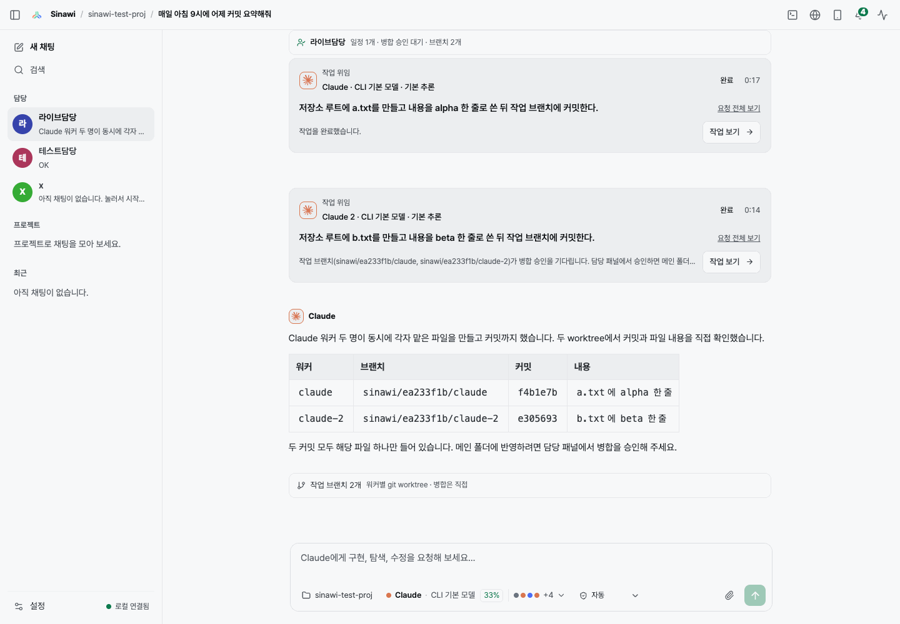
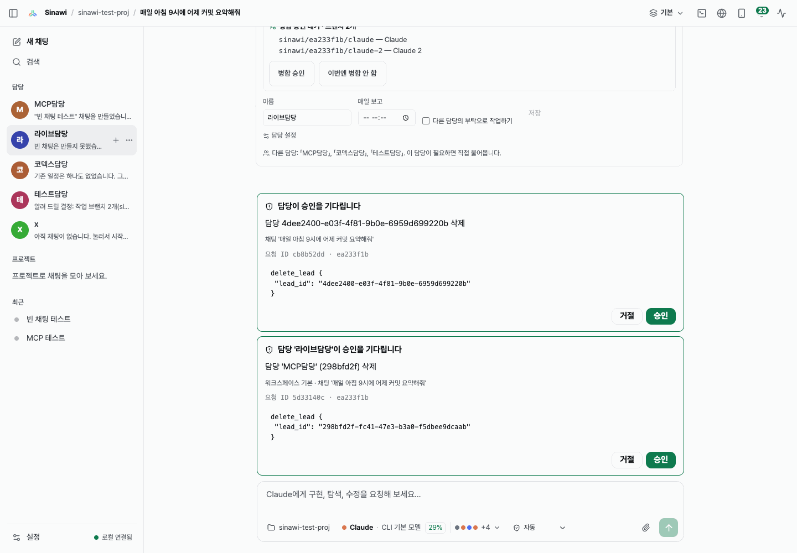
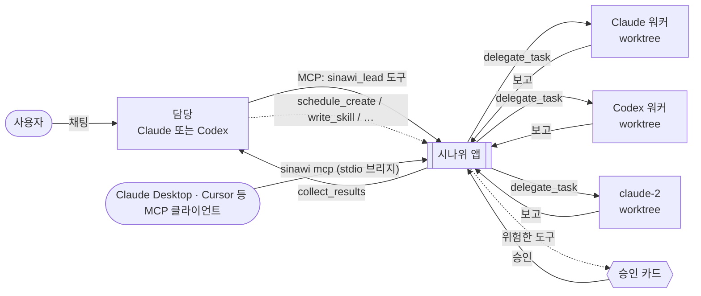

<div align="center">


# 시나위 (Sinawi)

**총괄 AI 하나, Claude Code · Codex · Grok Build 워커 팀, 그리고 채팅 하나.**

담당(총괄 AI)과 채팅만 하세요. 담당이 브리프와 스킬을 쓰고, 일을 병렬로 나눠 주고, MCP 도구로 앱 기능을 직접 씁니다. if문은 없습니다.

[](https://github.com/Rakmlabs/sinawi/releases/latest) [](https://github.com/Rakmlabs/sinawi/releases) [](#설치) [](docs/mcp.ko.md) [](LICENSE) [](https://github.com/Rakmlabs/sinawi/stargazers)

[English](README.md) · **한국어**

[다운로드](https://github.com/Rakmlabs/sinawi/releases/latest) · [동작 방식](#동작-방식) · [MCP](docs/mcp.ko.md) · [AI에게 붙여넣는 프롬프트](#ai에게-붙여넣는-프롬프트) · [AI 에이전트용](#ai-에이전트용-문서) · [협업 문의](#만든-곳-rakm)

<br />



<sub>담당이 Claude 워커 두 명에게 동시에 일을 맡기고, 두 worktree를 확인한 뒤 커밋을 보고했습니다.</sub>

</div>

---

## 왜 만들었나

가장 결과가 좋았던 방식은 코딩 에이전트 하나가 아니었습니다. **총괄 AI 하나가 프롬프트와 스킬을 쓰고 Claude, Codex에게 일을 나눠 주는 방식**이었습니다. 이걸 손으로 하면 터미널을 여러 개 띄우고 결과를 복사해 옮겨야 합니다.

시나위는 그 방식을 앱으로 만든 것입니다. 이미 쓰고 있는 코딩 에이전트 CLI(**Codex**, **Claude Code**, **Grok Build**)를 한 팀으로 돌리고, 모든 과정을 실시간으로 보여 줍니다.

이름은 정해진 악보 없이 즉흥으로 합을 맞추는 우리 음악 *시나위*에서 따왔습니다.

## 핵심 기능

<table>
<tr>
<td width="50%" valign="top">

### 💬 담당과 채팅만 하면 됩니다
**담당**은 프로젝트 하나를 맡는 오래가는 채팅입니다. 계속 일을 주면, 요청을 쪼개고 구조화된 브리프(목표, 맥락, 완료 기준, 제약, 검증, 보고 형식)를 쓰고 맞는 스킬을 고릅니다.

</td>
<td width="50%" valign="top">

### ⚡ 병렬 워커
`delegate_task`, `check_task`, `collect_results`. 워커가 바쁘면 담당이 워커를 더 붙이고(`claude-2` 등), 각자 자기 git worktree에서 일합니다. 디자인 작업은 스크린샷과 함께 돌아옵니다.

</td>
</tr>
<tr>
<td valign="top">

### 🧠 if문이 아니라 AI가 판단합니다
앱의 모든 기능이 MCP 도구(**89개**)로 열려 있습니다. 담당이 대화를 보고 무엇을 부를지 정합니다. 스킬 작성, 채팅·공간·담당 생성, 일정 만들기까지.

</td>
<td valign="top">

### 🛡️ 위험한 작업은 승인 카드로
삭제, 설정 변경, 병합, 터미널 명령(도구 28개)은 앱에서 승인해야 실행됩니다. AI가 자기 요청을 스스로 승인하는 도구는 없습니다. 담당별 병합 정책은 `auto`, `ask`, `never`.

</td>
</tr>
<tr>
<td valign="top">

### 🗓️ 대화하다 생기는 일정
*"매일 아침 9시에 어제 커밋 요약해줘"*라고 하면 담당이 직접 cron 일정을 만듭니다. 한 번 또는 반복, Mac 시간대 기준, 담당 설정에서 관리합니다.

</td>
<td valign="top">

### 🔌 바깥 AI도 조종할 수 있습니다
Claude Desktop, Cursor 같은 MCP 클라이언트가 앱 전체를 다룰 수 있습니다. **설정 → 일반 → 외부 AI 연결 (MCP)**에서 Claude Desktop이나 Cursor를 버튼 하나로 연결합니다.

</td>
</tr>
</table>

<div align="center">


<br />
<sub>왼쪽: 담당이 스스로 만든 일정. 오른쪽: 담당 삭제는 승인을 기다립니다.</sub>
</div>

## 동작 방식



1. 평소처럼 담당과 채팅합니다.
2. 앱이 MCP로 담당에게 도구를 줍니다. 무엇을 쓸지는 담당이 정합니다.
3. 워커는 각자 worktree에서 병렬로 일하고, 시나위가 보고를 확인해 결과를 돌려줍니다.
4. 되돌릴 수 없는 작업은 승인 카드에서 멈추고 결정을 기다립니다.

> [!NOTE]
> MCP 도구는 Claude, Codex 담당이 씁니다. **Grok 담당**은 실행마다 MCP를 붙이는 방법이 아직 없어서 텍스트 태그 방식으로 동작하고, 이 도구들은 쓸 수 없습니다.

## 설치

**[최신 릴리즈](https://github.com/Rakmlabs/sinawi/releases/latest)**에서 `Sinawi_<버전>_universal.dmg`를 받아 열고 **Sinawi**를 **응용 프로그램**으로 끌어다 놓으세요.

[`@rakmlabs/sinawi`](packages/sinawi) npm 패키지로 터미널에서도 설치할 수 있습니다:

```sh
npx @rakmlabs/sinawi
```

최신 릴리즈를 받아 `codesign`·`spctl`로 확인하고, 이미 있는 앱을 바꿀지 물은 뒤 엽니다(`--yes`, `--no-open`, `--help`).

- Developer ID로 서명되고 Apple 공증을 받아 Gatekeeper 경고 없이 열립니다.
- Apple Silicon과 Intel 모두 네이티브로 동작합니다.
- 이후에는 GitHub Releases에서 자동 업데이트됩니다(재시작 시점은 직접 고릅니다).

### 요구 사항

- macOS
- [Node.js](https://nodejs.org) **24.22.1 이상 권장**(22.x는 2026-10-20 보안 릴리즈인 22.23.4 이상), 로그인 셸 `PATH`에 있어야 합니다. Apple Silicon에서는 arm64 Node를 쓰세요
- 다음 CLI 중 하나 이상 설치 및 로그인: [Codex CLI](https://github.com/openai/codex) · [Claude Code](https://docs.anthropic.com/en/docs/claude-code/setup) · [Grok Build](https://docs.x.ai/build/overview)

시나위는 로그인 셸의 `PATH`와 흔한 설치 위치에서 CLI를 찾습니다. 앱의 **설정 → 도움말 및 설정 도우미**에서 찾은 CLI와 로그인 방법을 볼 수 있습니다. API 키는 묻지도 저장하지도 않고, 각 CLI의 로그인을 그대로 씁니다.

## 바깥 AI 연결 (MCP)

Claude Desktop, Cursor 같은 MCP 클라이언트가 작은 stdio 브리지로 앱 전체를 다룰 수 있습니다. 연결 방법은 쉬운 순서로 셋입니다.

1. **버튼 하나.** 시나위 **설정 → 일반 → 외부 AI 연결 (MCP)**에서 **Claude Desktop에 연결** 또는 **Cursor에 연결**을 누릅니다. 시나위가 넣을 JSON을 그대로 보여 준 뒤 `~/Library/Application Support/Claude/claude_desktop_config.json` 또는 `~/.cursor/mcp.json`에 씁니다(다른 항목은 그대로, 원래 파일은 `.bak`으로 남김). 그다음 클라이언트를 다시 시작하세요. 이 항목은 시나위의 토큰 파일을 읽으므로 토큰이 복사되지 않습니다.
2. **npx.** [`@rakmlabs/sinawi`](packages/sinawi) npm 패키지를 씁니다. 같은 화면의 **구성 복사**를 누르면 토큰이 채워진 다음 구성이 나옵니다:

   ```json
   {
     "mcpServers": {
       "sinawi": {
         "command": "npx",
         "args": ["-y", "@rakmlabs/sinawi", "mcp"],
         "env": { "SINAWI_URL": "http://127.0.0.1:3001", "SINAWI_MCP_TOKEN": "<설정 화면의 토큰>" }
       }
     }
   }
   ```

3. **앱 안의 브리지.** npm 없이 `"command": "node", "args": ["/Applications/Sinawi.app/Contents/Resources/sinawi-mcp.mjs"]`에 같은 `env`를 씁니다(클라이언트가 `node`를 못 찾으면 `which node`의 전체 경로를 쓰세요). 저장소에서는 `npm run sinawi-mcp`가 같은 파일을 실행합니다.

조회와 생성은 바로 실행되고, 위험한 도구는 승인 카드를 기다립니다. 자세한 안내: [docs/mcp.ko.md](docs/mcp.ko.md) · 도구 범위: [docs/mcp-coverage.md](docs/mcp-coverage.md)

## AI에게 붙여넣는 프롬프트

Claude Code, Codex처럼 Mac에서 명령을 실행할 수 있는 AI에 그대로 붙여 넣으세요.

**시나위 설치와 설정**

```text
시나위(Sinawi, https://github.com/Rakmlabs/sinawi)를 설치하고 설정하는 걸 도와줘. Claude Code, Codex, Grok Build CLI를 한 팀으로 돌리는 macOS 앱이야.

1. 앱을 설치해 줘. `npx @rakmlabs/sinawi`를 실행해. 최신 릴리즈를 받아 codesign·spctl로 서명을 확인하고, 이미 있는 /Applications/Sinawi.app을 바꿀지 물어본 뒤 앱을 열어 줘. 또는 https://github.com/Rakmlabs/sinawi/releases/latest 에서 최신 Sinawi_<버전>_universal.dmg를 받아 열고 Sinawi를 응용 프로그램으로 옮겨 줘. 서명·공증된 앱이야.
2. 로그인 셸 PATH의 Node.js를 확인해 줘(`node -v`). 24.22.1 이상을 권장하고, 22.x라면 22.23.4 이상이어야 해. Apple Silicon에서는 arm64 Node여야 해. 없거나 낮으면 설치해 줘(예: `brew install node`).
3. Git을 확인해 줘(`git --version`, 없으면 `xcode-select --install`).
4. 에이전트 CLI가 하나 이상 설치·로그인돼 있어야 해. 어떤 걸 쓸지 나에게 물어봐 줘:
   - Claude Code: `curl -fsSL https://claude.ai/install.sh | bash` 후 `claude auth login`
   - Codex CLI: `npm install -g @openai/codex` 후 `codex login`
   - Grok Build: `curl -fsSL https://x.ai/cli/install.sh | bash` 후 `grok login`
   로그인은 브라우저가 열리니 내가 직접 마칠게. 시나위는 API 키가 필요 없어.
5. 시나위를 터미널이 아니라 Finder나 Dock에서 열고, 설정 → 도움말 및 설정 도우미에서 Node, Git, CLI가 설치·로그인됨으로 보이는지 나에게 확인시켜 줘.
6. 못 찾는 게 있으면 `which` / `--version` 출력을 그대로 보여 주고 PATH를 고쳐 줘. ~/Library/Application Support/dev.sinawi.app 은 건드리지 마.
```

**내 AI를 MCP로 시나위에 연결**

```text
이 AI 클라이언트를 MCP로 시나위(https://github.com/Rakmlabs/sinawi)에 연결해 줘.

- 이 Mac에서 시나위가 켜져 있어야 해. API 주소는 http://127.0.0.1:3001 이야.
- Claude Desktop이나 Cursor라면 가장 쉬운 방법: 나에게 시나위 → 설정 → 일반 → 외부 AI 연결 (MCP)에서 "Claude Desktop에 연결" 또는 "Cursor에 연결"을 누르라고 해 줘. 시나위가 JSON을 보여 주고 클라이언트 구성에 써(.bak을 남김). 내가 클라이언트를 다시 시작하면 "확인"으로 넘어가.
- 아니면 이 클라이언트의 MCP 구성에 "sinawi"라는 mcpServers 항목을 직접 넣어 줘:
  - npm으로(`@rakmlabs/sinawi`): command "npx", args ["-y", "@rakmlabs/sinawi", "mcp"]
  - npm 없이: command "node", args ["/Applications/Sinawi.app/Contents/Resources/sinawi-mcp.mjs"]
  - env: SINAWI_URL "http://127.0.0.1:3001", 그리고 시나위 → 설정 → 일반 → 외부 AI 연결 (MCP) → "구성 복사"에 있는 SINAWI_MCP_TOKEN. 토큰은 내가 붙여 넣을게. 토큰을 다시 출력하거나 커밋하지 마.
  - Claude Code: `claude mcp add sinawi --env SINAWI_MCP_TOKEN=<토큰> -- npx -y @rakmlabs/sinawi mcp`
  그다음 클라이언트를 다시 시작해 줘.
- 확인: `sinawi` 도구 목록을 보고 `app_status`를 호출해 봐.
- 위험한 도구(삭제, 설정 변경, 병합, 터미널 명령)는 `pending_approval`을 돌려줘. 승인·거절은 내가 시나위의 승인 카드에서 해. 네가 직접 승인하려고 하지 마.
- 참고: https://github.com/Rakmlabs/sinawi/blob/main/docs/ai/for-ai.ko.md
```

**코드베이스 이해·기여**

```text
시나위 코드베이스(https://github.com/Rakmlabs/sinawi)를 이해하고, 필요하면 기여하고 싶어.

1. 저장소를 클론하고 llms.txt, AGENTS.md, docs/ai/for-ai.ko.md, CONTRIBUTING.md 순서로 읽어 줘.
2. 구조를 요약해 줘: server/(Express + WebSocket 서버, CLI 실행, 오케스트레이션, server/app-tools.ts의 MCP 도구 목록), src/(React UI, 문구는 src/i18n.ts에 한국어·영어), src-tauri/(Tauri v2 셸), packages/sinawi/(`@rakmlabs/sinawi`: 앱 설치기와 MCP 브리지).
3. Node는 ^22.23.4, ^24.22.1, >=26.12.1 중 하나를 써. `npm install` 후 `npm run typecheck`, `npm test`, `npm run build`를 돌려 줘. 변경을 마치기 전에 셋 다 통과해야 해.
4. AGENTS.md 규칙을 지켜: 3001 포트와 실제 앱 데이터는 쓰지 말고, 개발 서버는 `SINAWI_PORT=3011 SINAWI_UI_PORT=5198 SINAWI_DATA_DIR="$(mktemp -d)" npm run dev`로 띄워. server/app-tools.ts를 바꾸면 `npm run docs:ai`를 돌려. UI 문구는 두 언어 모두 넣어.
5. 내가 말하기 전에는 커밋, 푸시, 풀 리퀘스트를 하지 마. 브랜치는 main에서(fix/… 또는 feat/…) 만들고 CONTRIBUTING.md대로 이슈를 연결해.
```

<details>
<summary><b>그 밖의 기능</b></summary>

- **담당과 워커.** 담당과 워커 조합을 직접 고르거나, *자동* 라우팅이 요청에 맞는 팀, 모델, 스킬을 고르게 할 수 있습니다. 브리프의 빠진 부분을 채우고, 요약 과정에서 사용자의 원래 말이 빠지지 않게 덧붙입니다. 한 워커의 브리프는 차례로, 여러 워커는 동시에 실행됩니다.
- **권한 모드**(Claude Code와 같은 방식): *계획*(읽기 전용, 담당이 제안한 계획을 한 번에 실행), *자동*(프로젝트 폴더 안에서 수정하고 일반 명령은 묻지 않음, Claude Code는 CLI 자체 auto 모드 사용), *전체 권한*(공간이 허용할 때만).
- **실시간 보기.** 메시지, 도구 호출, 명령, 파일 변경이 생기는 대로 보이고, CI나 배포를 기다리는 중인지도 표시됩니다.
- **공간.** 대화, 프로젝트, 기본값을 나눠 둡니다(F1 / F2). 공간마다 실행할 수 있는 에이전트, 컴퓨터 제어·전체 권한 허용 여부, 막을 MCP 도구를 정합니다.
- **사용량 대체.** CLI 하나의 사용량이 바닥나기 직전이면 다음으로 정해 둔 에이전트로 역할을 넘길 수 있습니다.
- **내장 브라우저와 컴퓨터 제어.** 에이전트가 앱의 브라우저를, macOS 권한을 주면 다른 앱도 조작합니다. 세션과 워커마다 탭이 따로 있고, 페이지는 공간을 넘나들지 않습니다.
- **Worktree, 터미널, 파일.** git worktree, 세션별 터미널, 이미지·PDF·Markdown 미리보기.
- **입력창.** `1. `, `- `, Shift+Enter로 마크다운 리스트가 이어지고, 한글 조합 입력도 처리합니다.
- **슬래시 메뉴.** `/clear`, `/compact`, `/usage`와 설치된 모든 스킬.
- **스킬.** `~/.claude/skills`, `~/.codex/skills`, `~/.codex/prompts`, `~/.grok/skills`, 프로젝트의 `./skills`를 읽습니다. 스킬이 없는 CLI의 워커에게는 지침을 첨부합니다.
- **봇.** 에이전트, 모델, 스킬, 지침을 프리셋으로 저장하고, 봇 둘이 정한 횟수만큼 대화하게 할 수 있습니다.
- **사용량과 업데이트.** 에이전트별 사용량 추적과 서명된 자동 업데이트.

</details>

<details>
<summary><b>소스에서 빌드</b></summary>

[Rust](https://rustup.rs)와 Xcode Command Line Tools(`xcode-select --install`)가 필요합니다.

```sh
git clone https://github.com/Rakmlabs/sinawi.git
cd sinawi
npm install
npm run app:build
```

앱은 `src-tauri/target/release/bundle/macos/Sinawi.app`에 만들어집니다. 직접 빌드한 앱은 공증되지 않고 서명된 업데이트도 받지 않습니다.

개발:

```sh
npm run dev        # API 127.0.0.1:3001, 웹 UI http://127.0.0.1:5188
npm run app:dev    # Tauri 창에서 같은 환경
npm run typecheck && npm test && npm run build
```

두 서버 모두 `127.0.0.1`에만 열립니다. `SINAWI_PORT`, `SINAWI_DATA_DIR`로 API 포트와 데이터 폴더를 바꿀 수 있습니다.

| 경로 | 내용 |
|---|---|
| `server/` | Express + WebSocket 서버: CLI 실행, 오케스트레이션, 라우팅, 감독, 저장, MCP |
| `src/` | React UI |
| `src-tauri/` | Tauri v2 셸: 창, 업데이터, 내장 브라우저 브리지, 컴퓨터 제어 브리지 |
| `scripts/` | 개발 실행, 서버 번들러, 서명·릴리즈 스크립트 |
| `docs/orchestration/` | 앱이 담당과 워커에게 적용하는 운영 규칙 |
| `docs/RELEASING.md` | 릴리즈와 서명된 자동 업데이트 방식 |
| `docs/mcp.ko.md` | 담당, 일정, `sinawi_lead` 도구, 앱 전체 MCP 서버 |

</details>

<details>
<summary><b>권한과 데이터</b></summary>

에이전트가 처음 컴퓨터 제어를 쓰면 macOS가 **개인정보 보호 및 보안 → 손쉬운 사용**과 **화면 기록**에서 시나위를 허용하라고 묻습니다. macOS가 시나위 자체에 권한을 주도록, 터미널이 아니라 Finder나 Dock에서 여세요.

데이터는 `~/Library/Application Support/dev.sinawi.app/`, 로그는 `~/Library/Logs/Sinawi/`에 있습니다.

</details>

## FAQ

**API 키가 필요한가요?**
아니요. 각 CLI의 로그인을 씁니다. 프롬프트, 고른 스킬, 에이전트가 읽은 파일은 CLI를 직접 실행할 때처럼 그 CLI의 모델 제공사로 전송됩니다.

**샌드박스인가요?**
아니요. *계획*은 읽기 전용, *자동*은 프로젝트 폴더 안에서만 쓰고, *전체 권한*은 CLI 자체 샌드박스를 끄기 때문에 공간이 허용할 때만 켜집니다. 승인 카드는 MCP 도구만 막습니다. 셸을 가진 에이전트는 시나위의 로컬 HTTP API를 직접 부를 수 있습니다.

**Grok Build를 담당으로 쓸 수 있나요?**
네, 다만 지금은 MCP 도구 없이 동작합니다(위 안내 참고). 전체 도구는 Claude, Codex 담당이 씁니다.

**Windows나 Linux는요?**
지금은 macOS만 지원합니다.

## 로드맵

- [ ] Grok 담당용 MCP 도구
- [ ] Codex 담당의 MCP 도구 사용 전체 검증
- [ ] 정확한 분 단위 일정 실행(지금은 최대 1분 늦을 수 있음)
- [ ] 클라우드 AI용 원격 MCP 접속(터널)

## AI 에이전트용 문서

AI 에이전트와 MCP 클라이언트는 [llms.txt](llms.txt)와 [docs/ai/for-ai.ko.md](docs/ai/for-ai.ko.md)(개념, MCP 설정, 승인 여부를 포함한 전체 도구, 제한)부터 보세요. 이 저장소에서 일하는 코딩 에이전트는 [AGENTS.md](AGENTS.md)를 보세요.

## 기여하기

이슈와 풀 리퀘스트를 환영합니다. 이슈를 열거나 고르고, `main`에서 브랜치를 만든 뒤 이슈를 연결한 풀 리퀘스트를 보내 주세요. 설정, 검사, 규칙은 [CONTRIBUTING.md](CONTRIBUTING.md)에 있습니다.

## 만든 곳: rakm

<table>
<tr>
<td>

시나위는 **[rakm](https://github.com/Rakmlabs)**의 **최원락 (Won Rak Choi)**이 만들고 관리합니다.

rakm은 AI 네이티브 제품과 개발 도구를 만들고, 외주와 협업도 맡습니다. AI 에이전트 워크플로, MCP 연동, 데스크톱 앱(Tauri), 웹 프론트엔드.

**협업 문의:** [1rrock@rakm.co.kr](mailto:1rrock@rakm.co.kr) · [GitHub @Rakmlabs](https://github.com/Rakmlabs) · [LinkedIn @rakmlabs](https://www.linkedin.com/company/rakmlabs/)

</td>
</tr>
</table>

시나위가 도움이 됐다면 ⭐ 하나가 다른 사람이 찾는 데 큰 도움이 됩니다.

## Star History

<a href="https://star-history.com/#Rakmlabs/sinawi&Date">
  
</a>

## 라이선스

[MIT](LICENSE) © 2026 Rakmlabs
