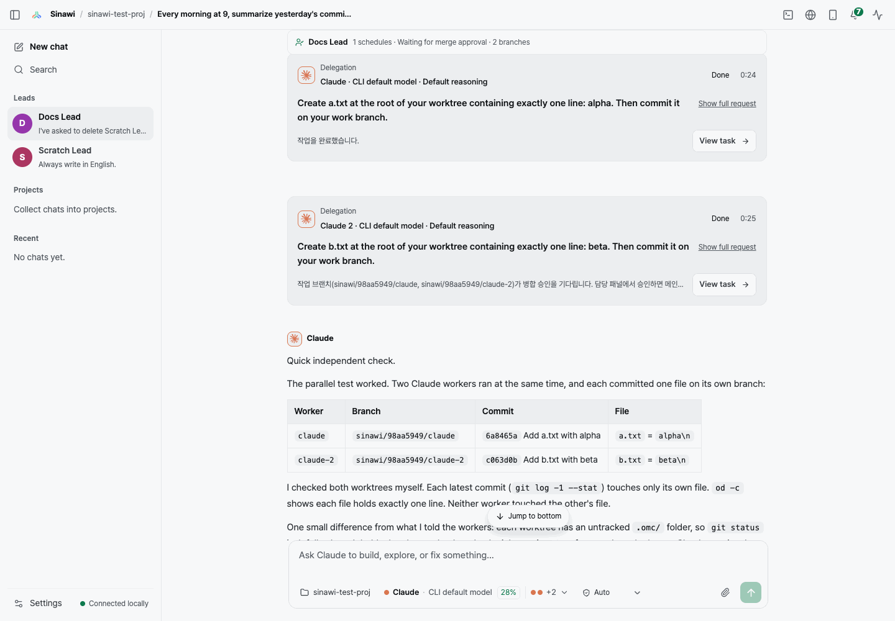
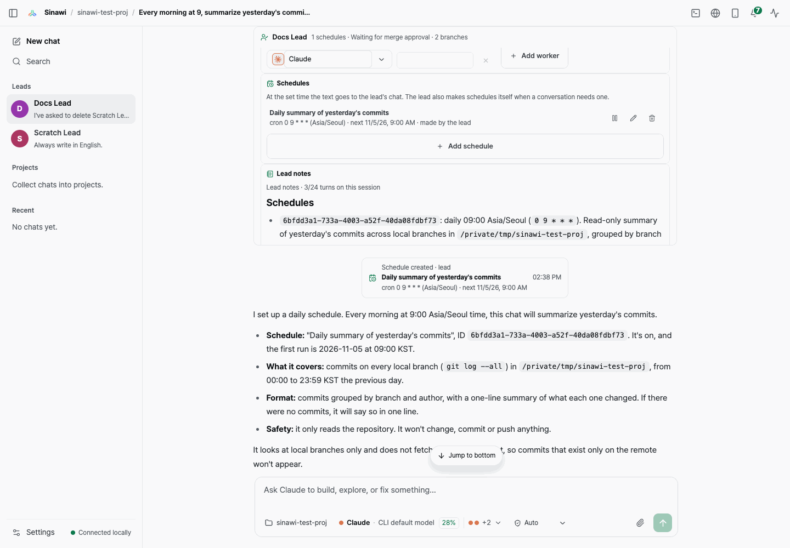
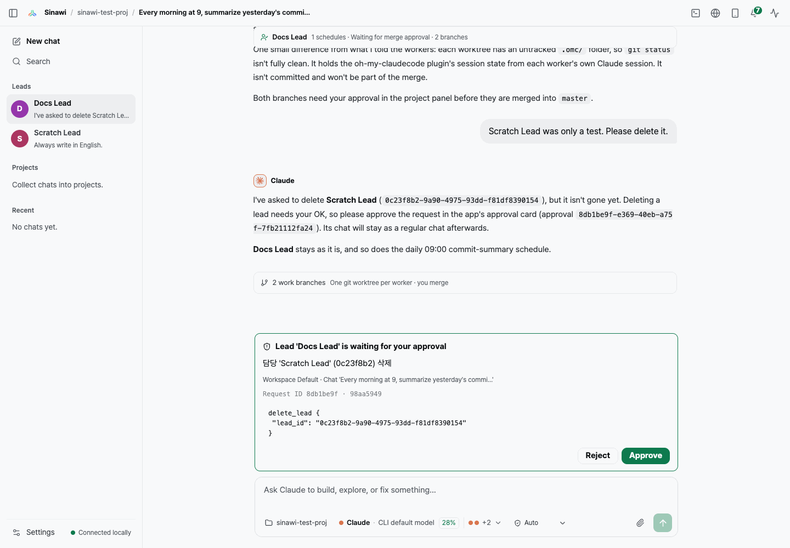
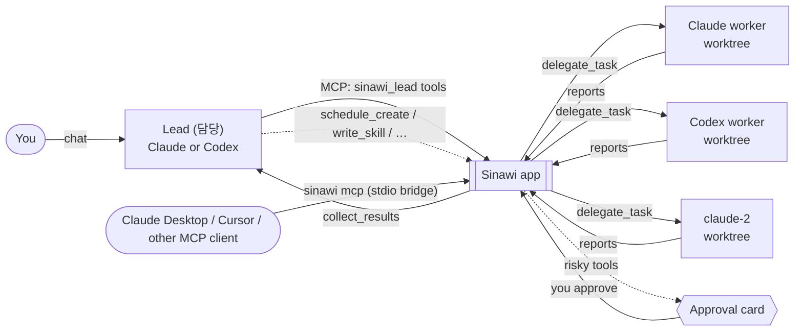

<div align="center">


# Sinawi

**One lead AI. A team of Claude Code, Codex and Grok Build workers. One chat.**

Chat with a lead that writes the briefs and skills, hands the work out in parallel, and uses the app itself through MCP tools. No if-rules.

[](https://github.com/Rakmlabs/sinawi/releases/latest) [](https://github.com/Rakmlabs/sinawi/releases) [](#install) [](docs/mcp.md) [](LICENSE) [](https://github.com/Rakmlabs/sinawi/stargazers)

**English** · [한국어](README.ko.md)

[Download](https://github.com/Rakmlabs/sinawi/releases/latest) · [How it works](#how-it-works) · [MCP](docs/mcp.md) · [Prompts for your AI](#copy-paste-prompts-for-your-ai) · [For AI agents](#for-ai-agents) · [Work with us](#built-by-rakm)

<br />



<sub>The lead sent two tasks to two Claude workers at the same time, checked both worktrees and reported the commits.</sub>

</div>

---

## Why

The setup that gave me the best results was not one coding agent. It was **one lead AI writing prompts and skills, then handing the work to Claude and Codex**. Doing that by hand means juggling terminals and copying output between them.

Sinawi turns that into an app. It runs the coding-agent CLIs you already have (**Codex**, **Claude Code** and **Grok Build**) as one team, and you watch every step live.

The name comes from *sinawi* (시나위), Korean improvised ensemble music where players find harmony without a fixed score.

## Highlights

<table>
<tr>
<td width="50%" valign="top">

### 💬 Just chat with the lead
A **project lead** (담당) is a long-lived chat that owns one project. Keep giving it work. It splits the request, writes structured briefs (goal, context, done criteria, constraints, verification, report format) and picks the skills that fit.

</td>
<td width="50%" valign="top">

### ⚡ Parallel workers
`delegate_task`, `check_task`, `collect_results`. When a worker is busy the lead adds another (`claude-2`, …), each in its own git worktree. Design tasks come back with screenshots.

</td>
</tr>
<tr>
<td valign="top">

### 🧠 The AI decides, not if-rules
Every feature of the app is an MCP tool (**89 tools**). The lead reads the conversation and decides what to call: write a skill, create a chat, a workspace, another lead, a schedule.

</td>
<td valign="top">

### 🛡️ Approval cards for risky actions
Deletes, setting changes, merges and terminal commands (28 tools) wait for your approval in the app. There is no tool for an AI to approve its own request. Merge policy per lead: `auto`, `ask` or `never`.

</td>
</tr>
<tr>
<td valign="top">

### 🗓️ Schedules from conversation
Say *"summarize yesterday's commits every morning at 9"* and the lead creates a cron schedule itself. Once or cron, in your Mac's time zone, managed in the lead's settings.

</td>
<td valign="top">

### 🔌 Other AIs can drive it
Claude Desktop, Cursor and other MCP clients can drive the whole app. **Settings → General → External AI connection (MCP)** connects Claude Desktop or Cursor in one click.

</td>
</tr>
</table>

<div align="center">


<br />
<sub>Left: a schedule the lead created by itself. Right: deleting a lead waits for approval.</sub>
</div>

## How it works



1. You talk to the lead in a normal chat.
2. The app gives the lead its tools over MCP. The lead decides which to call.
3. Workers run in parallel in their own worktrees; Sinawi checks their reports and sends results back.
4. Anything destructive pauses on an approval card until you decide.

> [!NOTE]
> Claude and Codex leads get the MCP tools. **Grok leads** have no per-run MCP flag yet, so they fall back to a text tag protocol and lack these tools.

## Install

Download `Sinawi_<version>_universal.dmg` from the **[latest release](https://github.com/Rakmlabs/sinawi/releases/latest)**, open it and drag **Sinawi** to **Applications**.

Or, once the [`sinawi`](packages/sinawi) npm package is published, from a terminal:

```sh
npx sinawi
```

It downloads the latest release, checks it with `codesign` and `spctl`, asks before replacing an existing app and opens it (`--yes`, `--no-open`, `--help`).

- Signed with a Developer ID and notarized by Apple, so it opens without a Gatekeeper warning.
- Native on Apple Silicon and Intel.
- Updates itself from GitHub Releases (you choose when to restart).

### Requirements

- macOS
- [Node.js](https://nodejs.org) **24.22.1 or newer recommended** (on 22.x, 22.23.4 or newer: the 2026-10-20 security release), on your login shell's `PATH`. Use an arm64 Node on Apple Silicon
- At least one of these CLIs, installed and logged in: [Codex CLI](https://github.com/openai/codex) · [Claude Code](https://docs.anthropic.com/en/docs/claude-code/setup) · [Grok Build](https://docs.x.ai/build/overview)

Sinawi finds the CLIs on your login shell's `PATH` and in common install locations. **Settings → Help & setup assistant** in the app shows which ones it found and how to log in. Sinawi never asks for or stores API keys; it uses each CLI's own login.

## Connect another AI (MCP)

Claude Desktop, Cursor and other MCP clients can use the whole app through a small stdio bridge. Three ways to connect, easiest first:

1. **One click.** In Sinawi, open **Settings → General → External AI connection (MCP)** and press **Connect to Claude Desktop** or **Connect to Cursor**. Sinawi shows the exact JSON it will merge, writes it into `~/Library/Application Support/Claude/claude_desktop_config.json` or `~/.cursor/mcp.json` (other entries stay, the original is kept as `.bak`), and you restart the client. The entry reads the token from Sinawi's token file, so no secret is copied.
2. **npx**, once the [`sinawi`](packages/sinawi) package is published to npm. **Copy config** on the same screen gives this, with your token filled in:

   ```json
   {
     "mcpServers": {
       "sinawi": {
         "command": "npx",
         "args": ["-y", "sinawi", "mcp"],
         "env": { "SINAWI_URL": "http://127.0.0.1:3001", "SINAWI_MCP_TOKEN": "<token from the settings screen>" }
       }
     }
   }
   ```

3. **The bridge inside the app**, no npm needed: `"command": "node", "args": ["/Applications/Sinawi.app/Contents/Resources/sinawi-mcp.mjs"]` with the same `env` (use the full path from `which node` if the client cannot find `node`). From a checkout, `npm run sinawi-mcp` runs the same file.

Reads and creates run at once; risky tools wait for an approval card. Full guide: [docs/mcp.md](docs/mcp.md) · tool coverage: [docs/mcp-coverage.md](docs/mcp-coverage.md).

## Copy-paste prompts for your AI

Paste one of these into Claude Code, Codex or any assistant that can run commands on your Mac.

**Install and set up Sinawi**

```text
Help me install and set up Sinawi (https://github.com/Rakmlabs/sinawi), a macOS app that runs the Claude Code, Codex and Grok Build CLIs as one team.

1. Install the app. If the npm package `sinawi` is published, run `npx sinawi`: it downloads the latest release, checks the signature with codesign and spctl, asks before replacing an existing /Applications/Sinawi.app, and opens it. Otherwise download the latest Sinawi_<version>_universal.dmg from https://github.com/Rakmlabs/sinawi/releases/latest, open it and drag Sinawi to Applications. It is signed and notarized.
2. Check Node.js on my login shell's PATH (`node -v`): 24.22.1 or newer is recommended; on 22.x it must be 22.23.4 or newer. On Apple Silicon it must be an arm64 Node. If it is missing or too old, install it (for example `brew install node`).
3. Check Git (`git --version`; if missing: `xcode-select --install`).
4. Make sure at least one agent CLI is installed and logged in, and ask me which ones I want:
   - Claude Code: `curl -fsSL https://claude.ai/install.sh | bash`, then `claude auth login`
   - Codex CLI: `npm install -g @openai/codex`, then `codex login`
   - Grok Build: `curl -fsSL https://x.ai/cli/install.sh | bash`, then `grok login`
   Logins open a browser; let me finish them myself. Sinawi never needs API keys.
5. Open Sinawi from Finder or the Dock (not from a terminal), then tell me to open Settings → Help & setup assistant and confirm Node, Git and my CLIs show as installed and logged in.
6. If something is not found, show me the exact `which` / `--version` output and fix my PATH. Do not touch ~/Library/Application Support/dev.sinawi.app.
```

**Connect my AI to Sinawi over MCP**

```text
Connect this AI client to Sinawi (https://github.com/Rakmlabs/sinawi) over MCP.

- Sinawi must be running on this Mac; its API is http://127.0.0.1:3001.
- Easiest for Claude Desktop or Cursor: ask me to open Sinawi → Settings → General → External AI connection (MCP) and press "Connect to Claude Desktop" or "Connect to Cursor". Sinawi shows the JSON, writes it into the client's config (keeping a .bak) and I restart the client. Then skip to "Verify".
- Otherwise add an mcpServers entry named "sinawi" to this client's MCP config yourself:
  - with npm (once the package `sinawi` is published): command "npx", args ["-y", "sinawi", "mcp"]
  - without npm: command "node", args ["/Applications/Sinawi.app/Contents/Resources/sinawi-mcp.mjs"]
  - env: SINAWI_URL "http://127.0.0.1:3001", and SINAWI_MCP_TOKEN from Sinawi → Settings → General → External AI connection (MCP) → "Copy config". Let me paste the token; never print it back or commit it.
  - Claude Code: `claude mcp add sinawi --env SINAWI_MCP_TOKEN=<token> -- npx -y sinawi mcp`
  Then restart the client.
- Verify: list the `sinawi` tools and call `app_status`.
- Risky tools (delete, settings, merge, terminal commands) return `pending_approval`; I approve or reject them on the approval card in Sinawi. Never try to approve them yourself.
- Reference: https://github.com/Rakmlabs/sinawi/blob/main/docs/ai/for-ai.md
```

**Understand or contribute to the codebase**

```text
I want to understand (and maybe contribute to) the Sinawi codebase: https://github.com/Rakmlabs/sinawi

1. Clone it and read, in this order: llms.txt, AGENTS.md, docs/ai/for-ai.md, CONTRIBUTING.md.
2. Summarize the layout for me: server/ (Express + WebSocket server, CLI runners, orchestration, MCP tool registry in server/app-tools.ts), src/ (React UI, text in src/i18n.ts in Korean and English), src-tauri/ (Tauri v2 shell), packages/sinawi/ (the `sinawi` npm package: app installer and MCP bridge).
3. Use Node ^22.23.4, ^24.22.1 or >=26.12.1. Run `npm install`, then `npm run typecheck`, `npm test` and `npm run build`; all three must pass before any change is done.
4. Follow AGENTS.md: never use port 3001 or the real app data; for a dev server use `SINAWI_PORT=3011 SINAWI_UI_PORT=5198 SINAWI_DATA_DIR="$(mktemp -d)" npm run dev`. If you change server/app-tools.ts, run `npm run docs:ai`. Add UI text in both languages.
5. Do not commit, push or open a pull request until I say so. Branch from main (fix/… or feat/…) and link an issue, as CONTRIBUTING.md describes.
```

<details>
<summary><b>Everything else Sinawi does</b></summary>

- **Lead and workers.** Pick a lead and any mix of workers, or let *Auto* routing choose a team, models and skills for the request. Sinawi fills in missing brief parts and adds the user's own words so nothing is lost in the summary. One worker's briefs run in order; several workers run at the same time.
- **Permission modes**, like Claude Code: *Plan* (read-only, the lead proposes a plan you can run with one click), *Auto* (edits in the project folder without stopping for ordinary commands; with Claude Code it uses the CLI's own auto mode), and *Full access* (only when the workspace allows it).
- **Live view.** Messages, tool calls, commands and file changes stream in as they happen, including when the team is waiting on a CI run or deploy.
- **Workspaces.** Keep conversations, projects and defaults apart (F1 / F2). Each workspace has its own policy: which agents may run, whether computer control or full access is allowed, and which MCP tools are blocked.
- **Quota fallback.** When one CLI is about to run out of quota, Sinawi can switch that role to the next agent you configured.
- **Built-in browser and computer use.** Agents can drive the app's own browser and, with your macOS permission, other native apps. Each session and worker gets its own tab; pages never cross workspaces.
- **Worktrees, terminal and files.** Git worktrees, a terminal per session, previews of images, PDFs and Markdown.
- **Composer.** Markdown lists continue as you type (`1. `, `- `, Shift+Enter), with Korean IME handled.
- **Slash menu.** `/clear`, `/compact`, `/usage` and every installed skill.
- **Skills.** Reads `~/.claude/skills`, `~/.codex/skills`, `~/.codex/prompts`, `~/.grok/skills` and the project's `./skills`; a worker whose CLI lacks a skill gets its instructions attached.
- **Bots.** Save presets (agent, model, skills, instructions) and let two bots talk for a set number of turns.
- **Usage and updates.** Per-agent usage tracking and signed auto-updates.

</details>

<details>
<summary><b>Build from source</b></summary>

You need [Rust](https://rustup.rs) and the Xcode Command Line Tools (`xcode-select --install`).

```sh
git clone https://github.com/Rakmlabs/sinawi.git
cd sinawi
npm install
npm run app:build
```

The app is written to `src-tauri/target/release/bundle/macos/Sinawi.app`. A build you make yourself is not notarized and does not receive signed updates.

Development:

```sh
npm run dev        # API on 127.0.0.1:3001, web UI on http://127.0.0.1:5188
npm run app:dev    # the same inside the Tauri window
npm run typecheck && npm test && npm run build
```

Both servers bind to `127.0.0.1` only. `SINAWI_PORT` and `SINAWI_DATA_DIR` change the API port and data folder.

| Path | What it holds |
|---|---|
| `server/` | Express + WebSocket server: CLI runners, orchestration, routing, supervision, storage, MCP |
| `src/` | React UI |
| `src-tauri/` | Tauri v2 shell: window, updater, in-app browser bridge, computer-use bridge |
| `scripts/` | Dev runner, server bundler, signing and release scripts |
| `docs/orchestration/` | Operating rules the app enforces on leads and workers |
| `docs/RELEASING.md` | How releases and signed auto-updates work |
| `docs/mcp.md` | Project leads, schedules, `sinawi_lead` tools and the app-wide MCP server |

</details>

<details>
<summary><b>Permissions and data</b></summary>

The first time an agent uses computer control, macOS asks you to allow Sinawi under **Privacy & Security → Accessibility** and **Screen Recording**. Open Sinawi from Finder or the Dock (not from a terminal) so macOS grants the permission to Sinawi itself.

Data lives in `~/Library/Application Support/dev.sinawi.app/` and logs in `~/Library/Logs/Sinawi/`.

</details>

## FAQ

**Does Sinawi need API keys?**
No. It uses each CLI's own login. Your prompts, selected skills and files the agents read go to that CLI's model provider, as they would if you ran the CLI yourself.

**Is it a sandbox?**
No. *Plan* is read-only, *Auto* keeps writes inside the project folder, and *Full access* turns off the CLIs' own sandboxes, so it is off unless a workspace allows it. Approval cards guard the MCP tools only; an agent with a shell can still call Sinawi's local HTTP API directly.

**Can a Grok Build agent be the lead?**
Yes, but without the MCP tools for now (see the note above). Claude or Codex leads get the full toolset.

**Windows or Linux?**
macOS only today.

## Roadmap

- [ ] MCP tools for Grok leads
- [ ] Verify Codex leads end to end with the MCP tools
- [ ] Exact-minute schedule firing (today they can run up to a minute late)
- [ ] Remote MCP access for cloud AIs (tunnel)

## For AI agents

AI agents and MCP clients: start with [llms.txt](llms.txt) and [docs/ai/for-ai.md](docs/ai/for-ai.md) (concepts, MCP setup, every tool with its approval flag, limits). Coding agents working on this repo: [AGENTS.md](AGENTS.md).

## Contributing

Issues and pull requests are welcome. Open or pick an issue, branch from `main`, and send a pull request that links it. [CONTRIBUTING.md](CONTRIBUTING.md) has the setup, checks and conventions.

## Built by rakm

<table>
<tr>
<td>

Sinawi is built and maintained by **Won Rak Choi (최원락)** at **[rakm](https://github.com/Rakmlabs)**.

rakm builds AI-native products and developer tools, and takes on outsourcing and partnership work: AI agent workflows, MCP integrations, desktop apps (Tauri) and web front ends.

**Work with us:** [1rrock@rakm.co.kr](mailto:1rrock@rakm.co.kr) · [GitHub @Rakmlabs](https://github.com/Rakmlabs) · LinkedIn: <!-- TODO: add LinkedIn profile URL --> _coming soon_

</td>
</tr>
</table>

If Sinawi helps you, a ⭐ helps others find it.

## Star History

<a href="https://star-history.com/#Rakmlabs/sinawi&Date">
  
</a>

## License

[MIT](LICENSE) © 2026 Rakmlabs
