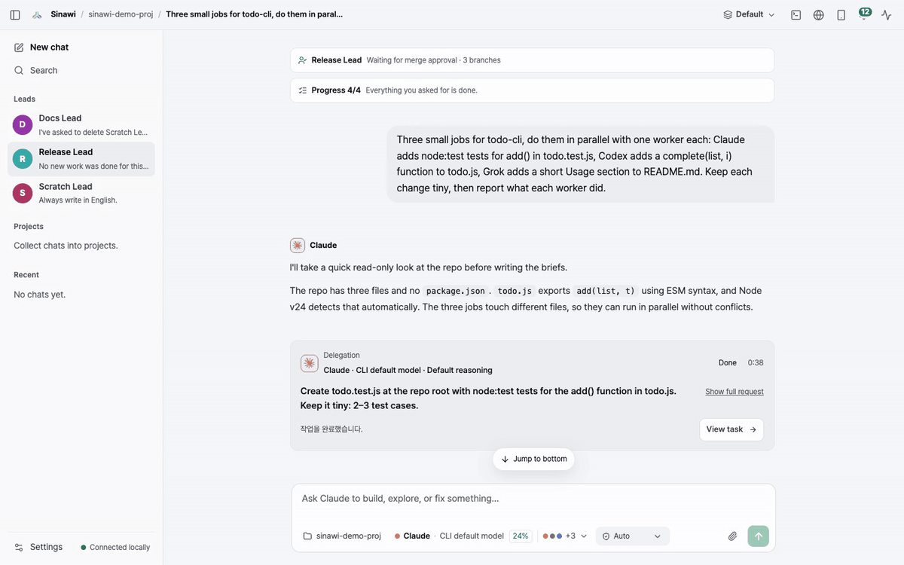
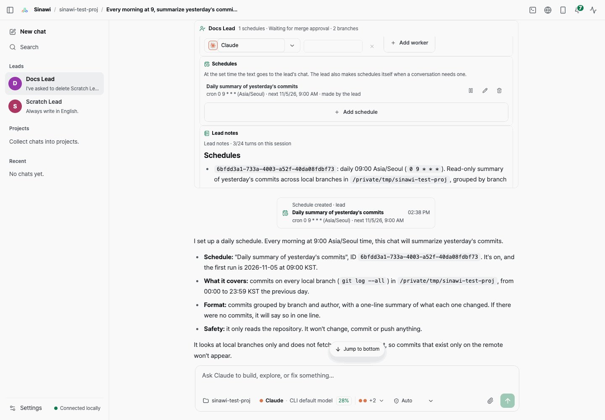
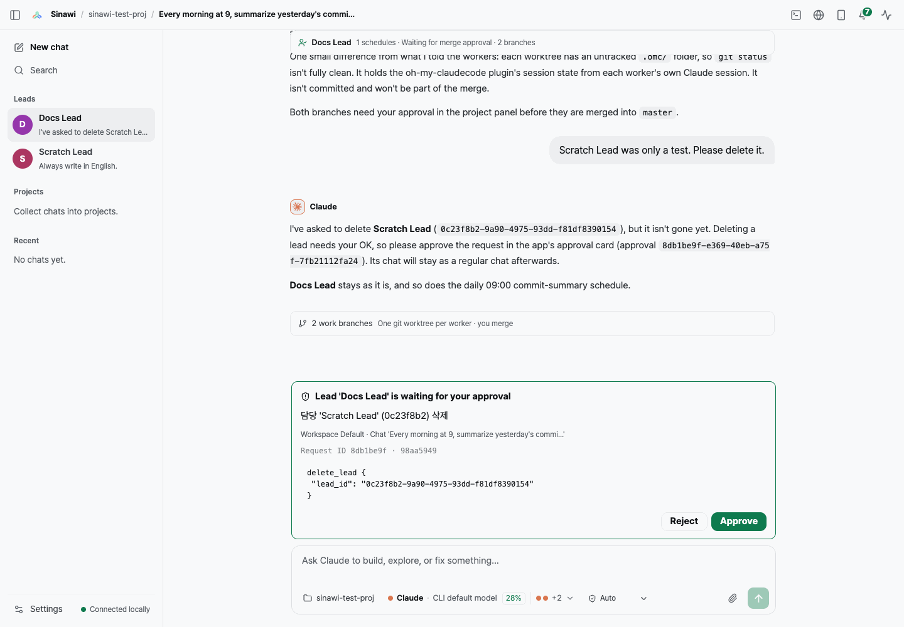
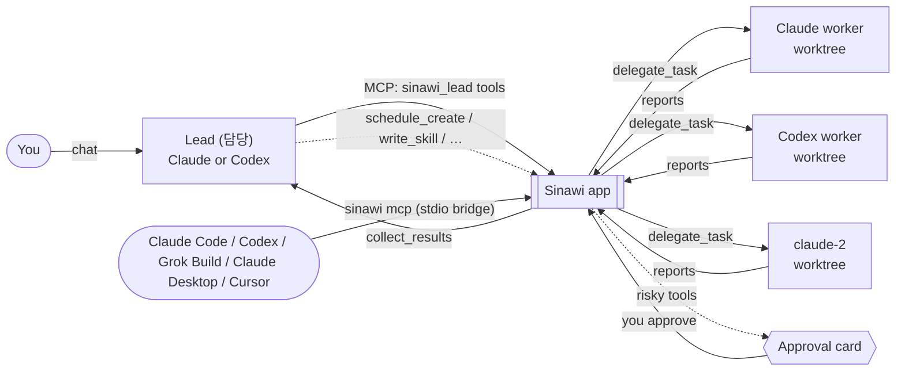

<div align="center">


# Sinawi

**Your AI hands coding work to Claude Code, Codex and Grok. Sinawi lets you watch those conversations live and step in.**

A Mac app and MCP server: Claude Code, Codex, Grok Build, Claude Desktop, Cursor or any MCP client opens chats in Sinawi, and each one is a normal chat you can read and type into. You can also chat with a project lead yourself.

[](https://github.com/Rakmlabs/sinawi/releases/latest) [](https://github.com/Rakmlabs/sinawi/releases) [](#install) [](docs/mcp.md) [](LICENSE) [](https://github.com/Rakmlabs/sinawi/stargazers)

**English** · [한국어](README.ko.md)

[Download](https://github.com/Rakmlabs/sinawi/releases/latest) · [Connect your AI](#connect-your-ai-mcp) · [How it works](#how-it-works) · [MCP](docs/mcp.md) · [Prompts for your AI](#copy-paste-prompts-for-your-ai) · [For AI agents](#for-ai-agents) · [Work with us](#built-by-rakm)

<br />



<sub>The lead sent two tasks to two Claude workers at the same time, checked both worktrees and reported the commits.</sub>

</div>

---

## What it is for

The setup that gave me the best results was not one coding agent. It was **one lead AI writing prompts and skills, then handing the work to Claude and Codex**. But when one AI drives another over MCP, the orchestrator gets only the result and you never see the conversation in between. Sinawi opens that work as chats on your screen, so you can watch, step in, and approve anything risky.

Situations it is made for:

- **You use Claude Desktop or Cursor as the conductor.** It cannot write the code itself. Through Sinawi's `create_session` it opens the work in Claude Code or Codex; the real conversation runs in a Sinawi chat, and you can type "not that file, this one" right there.
- **You run one CLI (Claude Code, Codex or Grok Build) as the orchestrator and send work to another.** With a plain MCP sub-call the sub-agent's conversation stays hidden. In Sinawi each task is a named chat you (and the orchestrator, with `get_session`) can read again later.
- **You give the same task to several models and keep the best.** The orchestrator opens a chat each for Claude, Codex and Grok; you watch them side by side and correct the one that drifts.

The name comes from *sinawi* (시나위), Korean improvised ensemble music where players find harmony without a fixed score.

## Highlights

<table>
<tr>
<td width="50%" valign="top">

### 🔌 Your AI hands work to Sinawi; you watch
An outside AI calls `list_leads`, then `create_session`: a new chat opens as a tab of that lead, with the agent and model it picked. `wait_for_session` waits until the turn is done and returns the new messages, `send_message` continues, `show_session` brings the chat up in the app. Its messages carry a badge like *sent by Grok Build via MCP* and the tab shows a plug icon. You can type in the same chat.

</td>
<td width="50%" valign="top">

### 💬 Chat with the lead yourself
A **project lead** (담당) owns one project. It has several chats, shown as tabs above the conversation: they share the folder, instructions and notes, each with its own history. Give it work and it splits the request, writes structured briefs (goal, context, done criteria, constraints, verification, report format) and picks the skills that fit.

</td>
</tr>
<tr>
<td valign="top">

### ⚡ Parallel workers
`delegate_task`, `check_task`, `collect_results`. When a worker is busy the lead adds another (`claude-2`, …), each in its own git worktree. Design tasks come back with screenshots.

</td>
<td valign="top">

### 🧠 The AI decides, not if-rules
Every feature of the app is an MCP tool (**91 tools**). The lead reads the conversation and decides what to call: write a skill, create a chat, a workspace, another lead, a schedule.

</td>
</tr>
<tr>
<td valign="top">

### 🛡️ Approval cards for risky actions
Deletes, setting changes, merges and terminal commands (30 tools) wait for your approval in the app. There is no tool for an AI to approve its own request. Merge policy per lead: `auto`, `ask` or `never`.

</td>
<td valign="top">

### 🗓️ Schedules from conversation
Say *"summarize yesterday's commits every morning at 9"* and the lead creates a cron schedule itself. Once or cron, in your Mac's time zone, managed in the lead's settings.

</td>
</tr>
</table>

<div align="center">


<br />
<sub>Left: a schedule the lead created by itself. Right: deleting a lead waits for approval.</sub>
</div>

## How it works



1. You talk to the lead in a normal chat.
2. The app gives the lead its tools over MCP. The lead decides which to call.
3. Workers run in parallel in their own worktrees; Sinawi checks their reports and sends results back.
4. Anything destructive pauses on an approval card until you decide.
5. An outside AI uses the `sinawi` MCP server the same way; the chats it opens show up in the app like any other.

> [!NOTE]
> Claude and Codex leads get the MCP tools. **Grok leads** have no per-run MCP flag yet, so they fall back to a text tag protocol and lack these tools. This is only about Grok as a lead inside Sinawi: Grok Build as an outside AI connects over MCP like any other client.

## Spaces

A space (workspace, 공간) is a separate desk inside the app. Switch with **F1** / **F2** (first and second space) or from the header.

- **Its own chats, project groups and defaults**: folder, team, allowed agents, quota fallback.
- **Its own leads (담당).** The sidebar, the new-chat lead picker and `list_leads` show only the current space's leads. A lead and all its chats live in one space; moving one moves the others, and leads only ask leads in their own space.
- **Its own policy** (Settings › Workspaces): image/video generation, computer control, full access, Grok MCP, blocked MCP tools.
- **Optional CLI accounts per space.** Give a space its own folder for Claude Code, Codex or Grok Build, and every run there (lead, workers, router) gets `CLAUDE_CONFIG_DIR`, `CODEX_HOME` or `GROK_HOME` set to it: a work login in one space, a personal one in another. Each folder keeps its own login, settings, history and skills, and limits are tracked per account. Log in once from a terminal, e.g. `CODEX_HOME=/Users/you/accounts/work-codex codex login` (Settings shows the exact command). Empty means the CLI's default login.

## Install

Download `Sinawi_<version>_universal.dmg` from the **[latest release](https://github.com/Rakmlabs/sinawi/releases/latest)**, open it and drag **Sinawi** to **Applications**.

- Signed with a Developer ID and notarized by Apple, so it opens without a Gatekeeper warning.
- Native on Apple Silicon and Intel.
- Updates itself from GitHub Releases (you choose when to restart).

> [!NOTE]
> After the npm package is published: `npx @rakmlabs/sinawi` will download the latest release, check it with `codesign` and `spctl`, ask before replacing an existing app and open it (`--yes`, `--no-open`, `--help`). [`@rakmlabs/sinawi`](packages/sinawi) is not on npm yet, so use the DMG for now.

### Requirements

- macOS
- [Node.js](https://nodejs.org) **24.22.1 or newer recommended** (on 22.x, 22.23.4 or newer: the 2026-10-20 security release), on your login shell's `PATH`. Use an arm64 Node on Apple Silicon
- At least one of these CLIs, installed and logged in: [Codex CLI](https://github.com/openai/codex) · [Claude Code](https://docs.anthropic.com/en/docs/claude-code/setup) · [Grok Build](https://docs.x.ai/build/overview)

Sinawi finds the CLIs on your login shell's `PATH` and in common install locations. **Settings → Help & setup assistant** in the app shows which ones it found and how to log in. Sinawi never asks for or stores API keys; it uses each CLI's own login.

## Connect your AI (MCP)

Any MCP client can hand work to Sinawi through a small stdio bridge that ships inside the app. The usual flow:

1. `list_leads` finds the lead (담당) for the project.
2. `create_session(lead_id, prompt, title, agent, model)` opens a new chat (tab) of that lead with the agent and model the AI picked (empty = the lead's own) and starts the work.
3. `wait_for_session(session_id, after_event_id)` waits until it is done and returns the new messages and the last answer.
4. `send_message` continues the same chat; `show_session` asks the user to look at it (without taking the screen they are on).

You see each of these chats live in Sinawi, with a badge on the messages the outside AI sent, and you can type in them too.

**Settings → Connect an AI** has a tab for each client (Claude Code, Codex, Grok Build, Claude Desktop, Cursor, Other MCP) with a command to copy, filled in with the exact paths on your Mac. Claude Desktop and Cursor also get a one-click connect. The same page has **instructions for the outside AI** to paste into its prompt or skill.

The commands for the installed app:

```sh
# Claude Code
claude mcp add sinawi --scope user -- node /Applications/Sinawi.app/Contents/Resources/sinawi-mcp.mjs
# Codex
codex mcp add sinawi -- node /Applications/Sinawi.app/Contents/Resources/sinawi-mcp.mjs
# Grok Build
grok mcp add sinawi -- node /Applications/Sinawi.app/Contents/Resources/sinawi-mcp.mjs
```

Claude Desktop, Cursor and other clients:

```json
{
  "mcpServers": {
    "sinawi": {
      "command": "node",
      "args": ["/Applications/Sinawi.app/Contents/Resources/sinawi-mcp.mjs"]
    }
  }
}
```

Use the full path from `which node` if the client cannot find `node`. On the same Mac the bridge reads the token from its file (`~/Library/Application Support/dev.sinawi.app/.data/app-mcp-token`) by itself, so no secret goes into the config. Set `SINAWI_MCP_TOKEN` only for a client on another setup. From a checkout, `npm run sinawi-mcp` runs the same bridge.

Tested: Claude Code and Grok Build actually connected (Grok found 81 tools); for Codex only the config was registered, the handshake was not checked.

**Cloud agents (Grok Bot, Codex dots) cannot connect today.** Both run on their own cloud computers, and Sinawi accepts connections from this Mac only. Grok Bot is a different product from Grok Build, the CLI on your Mac. What is and is not confirmed: [docs/mcp-clients.md](docs/mcp-clients.md) §6-1 and the tabs of the same names in Settings.

> [!NOTE]
> After the npm package is published: `npx -y @rakmlabs/sinawi mcp` will work in place of `node …/sinawi-mcp.mjs`.

Reads and creates run at once; risky tools wait for an approval card. Full guide: [docs/mcp.md](docs/mcp.md) · per-client details (Korean): [docs/mcp-clients.md](docs/mcp-clients.md) · tool coverage: [docs/mcp-coverage.md](docs/mcp-coverage.md).

## Copy-paste prompts for your AI

Paste one of these into Claude Code, Codex or any assistant that can run commands on your Mac.

**Install and set up Sinawi**

```text
Help me install and set up Sinawi (https://github.com/Rakmlabs/sinawi), a macOS app where my AI hands coding work to the Claude Code, Codex and Grok Build CLIs over MCP and I watch those chats live.

1. Install the app: download the latest Sinawi_<version>_universal.dmg from https://github.com/Rakmlabs/sinawi/releases/latest, open it and drag Sinawi to Applications. It is signed and notarized. (The npm installer `npx @rakmlabs/sinawi` is not published yet.)
2. Check Node.js on my login shell's PATH (`node -v`): 24.22.1 or newer is recommended; on 22.x it must be 22.23.4 or newer. On Apple Silicon it must be an arm64 Node. If it is missing or too old, install it (for example `brew install node`).
3. Check Git (`git --version`; if missing: `xcode-select --install`).
4. Make sure at least one agent CLI is installed and logged in, and ask me which ones I want:
   - Claude Code: `curl -fsSL https://claude.ai/install.sh | bash`, then `claude auth login`
   - Codex CLI: `npm install -g @openai/codex`, then `codex login`
   - Grok Build: `curl -fsSL https://x.ai/cli/install.sh | bash`, then `grok login`
   Logins open a browser; let me finish them myself. Sinawi never needs API keys.
5. Open Sinawi from Finder or the Dock (not from a terminal), then tell me to open Settings → Help & setup assistant and confirm Node, Git and my CLIs show as installed and logged in.
6. If something is not found, show me the exact `which` / `--version` output and fix my PATH. Do not touch ~/Library/Application Support/dev.sinawi.app.
```

**Connect my AI to Sinawi over MCP**

```text
Connect this AI client to Sinawi (https://github.com/Rakmlabs/sinawi) over MCP.

- Sinawi must be installed in /Applications and running on this Mac.
- Easiest: ask me to open Sinawi → Settings → Connect an AI, pick this client's tab and copy its command (it has the exact paths). For Claude Desktop or Cursor there is a one-click connect; then I restart the client and you skip to "Verify".
- Otherwise register the bridge yourself:
  - Claude Code: `claude mcp add sinawi --scope user -- node /Applications/Sinawi.app/Contents/Resources/sinawi-mcp.mjs`
  - Codex: `codex mcp add sinawi -- node /Applications/Sinawi.app/Contents/Resources/sinawi-mcp.mjs`
  - Grok Build: `grok mcp add sinawi -- node /Applications/Sinawi.app/Contents/Resources/sinawi-mcp.mjs`
  - Claude Desktop, Cursor or another client: an mcpServers entry "sinawi" with command "node", args ["/Applications/Sinawi.app/Contents/Resources/sinawi-mcp.mjs"]. Use the full path from `which node` if the client cannot find node.
  On this Mac the bridge reads Sinawi's token file by itself, so do not ask me for a token or put one in the config. (SINAWI_MCP_TOKEN is only for a client on another setup.) Then restart the client.
- Verify: list the `sinawi` tools and call `app_status`.
- To hand off work: `list_leads` → `create_session(lead_id, prompt, title, agent, model)` → `wait_for_session(session_id, after_event_id)` → `send_message` to continue → `show_session` to bring the chat up for me. I may type in the same chat, so read the new messages before your next instruction.
- Risky tools (delete, settings, merge, terminal commands) return `pending_approval`; I approve or reject them on the approval card in Sinawi. Never try to approve them yourself.
- Reference: https://github.com/Rakmlabs/sinawi/blob/main/docs/ai/for-ai.md
```

**Understand or contribute to the codebase**

```text
I want to understand (and maybe contribute to) the Sinawi codebase: https://github.com/Rakmlabs/sinawi

1. Clone it and read, in this order: llms.txt, AGENTS.md, docs/ai/for-ai.md, CONTRIBUTING.md.
2. Summarize the layout for me: server/ (Express + WebSocket server, CLI runners, orchestration, MCP tool registry in server/app-tools.ts), src/ (React UI, text in src/i18n.ts in Korean and English), src-tauri/ (Tauri v2 shell), packages/sinawi/ (`@rakmlabs/sinawi`: app installer and MCP bridge).
3. Use Node ^22.23.4, ^24.22.1 or >=26.12.1. Run `npm install`, then `npm run typecheck`, `npm test` and `npm run build`; all three must pass before any change is done.
4. Follow AGENTS.md: never use port 3001 or the real app data; for a dev server use `SINAWI_PORT=3011 SINAWI_UI_PORT=5198 SINAWI_DATA_DIR="$(mktemp -d)" npm run dev`. If you change server/app-tools.ts, run `npm run docs:ai`. Add UI text in both languages.
5. Do not commit, push or open a pull request until I say so. Branch from main (fix/… or feat/…) and link an issue, as CONTRIBUTING.md describes.
```

<details>
<summary><b>Everything else Sinawi does</b></summary>

- **Lead and workers.** Pick a lead and any mix of workers, or let *Auto* routing choose a team, models and skills for the request. Sinawi fills in missing brief parts and adds the user's own words so nothing is lost in the summary. One worker's briefs run in order; several workers run at the same time.
- **Permission modes**, like Claude Code: *Plan* (read-only, the lead proposes a plan you can run with one click), *Auto* (edits in the project folder without stopping for ordinary commands; with Claude Code it uses the CLI's own auto mode), and *Full access* (only when the workspace allows it).
- **Live view.** Messages, tool calls, commands and file changes stream in as they happen, including when the team is waiting on a CI run or deploy.
- **Workspaces.** Keep conversations, projects, leads and defaults apart (F1 / F2), each with its own policy and, optionally, its own CLI logins. See [Spaces](#spaces).
- **Quota fallback.** When one CLI is about to run out of quota, Sinawi can switch that role to the next agent you configured.
- **Built-in browser and computer use.** Agents can drive the app's own browser and, with your macOS permission, other native apps. Each session and worker gets its own tab; pages never cross workspaces.
- **Worktrees, terminal and files.** Git worktrees, a terminal per session, previews of images, PDFs and Markdown.
- **Composer.** Markdown lists continue as you type (`1. `, `- `, Shift+Enter), with Korean IME handled.
- **Slash menu.** `/clear`, `/compact`, `/usage` and every installed skill.
- **Skills.** Reads `~/.claude/skills`, `~/.codex/skills`, `~/.codex/prompts`, `~/.grok/skills` and the project's `./skills`; a worker whose CLI lacks a skill gets its instructions attached.
- **Bots.** Save presets (agent, model, skills, instructions) and let two bots talk for a set number of turns.
- **Usage and updates.** Per-agent usage tracking and signed auto-updates.

</details>

<details>
<summary><b>Build from source</b></summary>

You need [Rust](https://rustup.rs) and the Xcode Command Line Tools (`xcode-select --install`).

```sh
git clone https://github.com/Rakmlabs/sinawi.git
cd sinawi
npm install
npm run app:build
```

The app is written to `src-tauri/target/release/bundle/macos/Sinawi.app`. A build you make yourself is not notarized and does not receive signed updates. Without `TAURI_SIGNING_PRIVATE_KEY`, `npm run app:build` skips the updater artifacts and still succeeds.

npm 11 may warn about install scripts (`node-pty`, `esbuild`). `package.json` declares `allowScripts` and the server fixes the permissions of `node-pty`'s helper itself, so the warning can be ignored.

Development:

```sh
npm run dev        # API on 127.0.0.1:3001, web UI on http://127.0.0.1:5188
npm run app:dev    # the same inside the Tauri window
npm run typecheck && npm test && npm run build
```

`npm run dev` uses port 3001, which collides with an installed Sinawi that is running. To run beside it, with throwaway data:

```sh
SINAWI_PORT=3011 SINAWI_UI_PORT=5198 SINAWI_DATA_DIR="$(mktemp -d)" npm run dev
```

Both servers bind to `127.0.0.1` only. `SINAWI_PORT` and `SINAWI_DATA_DIR` change the API port and data folder; `SINAWI_UI_PORT` accepts only 5188 and 5198.

A port other than 3001 runs **isolated**: it does not watch the browser, computer and serve queues in `/tmp` that the installed app uses, and does not rewrite `~/.local/bin/ao-*` or the CLIs' skill folders (`SINAWI_ISOLATED=1` turns this on at 3001 too, `=0` turns it off).

**App window key.** What only the user may do (changing settings, approvals, merges, `/ws`, the terminal) needs more than an Origin header: a key the server makes fresh on every start and keeps in memory. No HTTP route hands it out.

- **Installed app:** the server offers the key on a unix socket, `<data>/run/app-key.sock`, in a folder only your user can enter. For each connection it runs the app binary with `--sinawi-check-peer`, which asks the kernel who connected (`LOCAL_PEERTOKEN`) and checks that process's running code against the app's own code signature (Security framework). argv[0], the process name or a claimed path do not count, and a modified app binary fails its signature.
- **`npm run dev`:** `scripts/dev.mjs` hands the key to the server on an inherited pipe (not in its environment, so `ps -E` does not show it) and prints a link with the key in its `#fragment`. Open that link; the page keeps the key for that tab and removes it from the address bar. The page Vite serves does not contain it. `npm run app:dev` gets it like the installed app, from the debug binary.

**What the key does not stop.** It keeps an ordinary local program (an agent running `curl`, another browser page) from acting as you. It does not stop a program that runs as your macOS user and sets out to get around it:
- It can connect to the socket, keep a copy of the connection in a second process and then exec the real app binary; the check then sees the real app and passes. This gap is known and pinned by a test (`peer_check.rs`).
- It can change the files the server runs from (the app bundle, the copied server in the app's data folder, the LaunchAgent plist) and restart it.
- On a build without the hardened runtime (a local bundle made without a Developer ID, a fork) it can start the real app binary with `DYLD_INSERT_LIBRARIES` or attach a debugger as the same user, and read the key inside a process that passes the check. The released app is signed with the hardened runtime, which closes this path.
- In dev mode it can read the key from the dev link in a terminal's scrollback, and from the history of the browser that first opened that link (the address bar drops it; the history keeps it).
- The key socket starts the app binary for each connection, so it runs at most four checks at once and closes further connections unanswered. The app window asks again a few times (within about 3 seconds); a program that keeps flooding the socket for longer can still keep the window from getting its key.
- Keeping an agent out of all of that needs the agent's process confined: a macOS sandbox profile or a separate user account for agent runs. Sinawi does not do that today, so treat agents in *auto* mode as programs running as you.

| Path | What it holds |
|---|---|
| `server/` | Express + WebSocket server: CLI runners, orchestration, routing, supervision, storage, MCP |
| `src/` | React UI |
| `src-tauri/` | Tauri v2 shell: window, updater, in-app browser bridge, computer-use bridge |
| `scripts/` | Dev runner, server bundler, signing and release scripts |
| `docs/orchestration/` | Operating rules the app enforces on leads and workers |
| `docs/RELEASING.md` | How releases and signed auto-updates work |
| `docs/mcp.md` | Project leads, schedules, `sinawi_lead` tools and the app-wide MCP server |

</details>

<details>
<summary><b>Permissions and data</b></summary>

The first time an agent uses computer control, macOS asks you to allow Sinawi under **Privacy & Security → Accessibility** and **Screen Recording**. Open Sinawi from Finder or the Dock (not from a terminal) so macOS grants the permission to Sinawi itself.

Data lives in `~/Library/Application Support/dev.sinawi.app/` and logs in `~/Library/Logs/Sinawi/`.

</details>

## FAQ

**Does Sinawi need API keys?**
No. It uses each CLI's own login. Your prompts, selected skills and files the agents read go to that CLI's model provider, as they would if you ran the CLI yourself.

**Is it a sandbox?**
No. *Plan* is read-only, and *Full access* turns off the CLIs' own sandboxes, so it is off unless a workspace allows it.

What *Auto* actually allows: file edits run without asking. Claude and Grok get `git` and `gh` (by subcommand: `git status`, `git commit`, `gh pr` …, so not `git -c …`, aliases or gh extensions), `curl`, `rg`, `ls`, `xcrun simctl` (by subcommand, never `spawn`), `ao-serve list/logs/stop` and others pre-approved. The forms of these that reach outside the project — `gh api` writes (`-X`, `-f`/`-F`, `--input`), forced or deleting `git push`, `xcrun simctl spawn`, `curl -K`, `trash` of a path outside the folder — make Claude ask on an approval card and are denied to Grok (also with the flag first). Grok does not guard paths and risky flags the way Claude Code does, so forms such as `rg --pre`, `curl -o`, `sort -o` and `git -c` are denied to it by rule too. The rules only see the text: they also deny `sort -o` into the project and `gh api -X GET`, and miss a flag inside a cluster (`curl -so x`). Commands that run any code and can reach files outside the project folder — `node`, `npx`, `python3`, `npm`, `pnpm`, `yarn` (their scripts and install hooks too), `find` (`-exec`) and `ao-serve start` — are governed by **Settings › Workspaces › Pre-approve commands that run code in auto mode** (off by default). While it is off, Sinawi's hook lets Claude run only two kinds of command without a card, also in Claude Code's own auto mode: one simple command that starts with a pre-approved program (every word fixed text, file arguments inside the project folder), and chains of safe read commands that stay in the folder (`cd src && cat a | head`). Everything else — the commands above, programs not on the list (`perl`, a shell script `./x.sh`), glued quotes (`"no""de"`, `n''ode`), `$(…)` and variables, `&&`, `;`, `|`, redirections, globs, paths outside the folder — gets an "ask" from the hook and an approval card. Grok is denied the commands above, the shells and wrappers that would start them (`bash`, `env`, `xargs` …), and any command containing `$`, a backtick, `;`, `&`, `|`, `<`, `>`, `\` or glued quotes. Grok has no mode that refuses without cancelling the run, so its own classifier decides other unlisted commands. Codex runs them only inside its own sandbox (writes to the project folder only, no network), and the server refuses `ao-serve start` from a Codex run (what the server starts is outside that sandbox). When one asks, its approval card links to the setting. While it is on, these commands run without asking and Claude and Grok decide unlisted commands by themselves (risky forms still ask or are denied). Not covered either way: what the project itself runs during an allowed command, such as a git hook or a filter in the repository's git config on `git commit`, which an agent that can edit files can set up. Use *Plan* for repositories or prompts you do not trust.

Approval cards guard the MCP tools. An agent with a shell can still call most of Sinawi's local HTTP API (reading, opening chats), but the user's own requests (approving, answering a permission, changing settings, the MCP token) only work from the app window.

**Can a Grok Build agent be the lead?**
Yes, but without the MCP tools for now (see the note above). Claude or Codex leads get the full toolset.

**Windows or Linux?**
macOS only today.

## Roadmap

- [ ] MCP tools for Grok leads
- [ ] Verify Codex leads end to end with the MCP tools
- [ ] Exact-minute schedule firing (today they can run up to a minute late)
- [ ] Remote MCP access for cloud AIs (tunnel)

## For AI agents

AI agents and MCP clients: start with [llms.txt](llms.txt) and [docs/ai/for-ai.md](docs/ai/for-ai.md) (concepts, MCP setup, every tool with its approval flag, limits). Coding agents working on this repo: [AGENTS.md](AGENTS.md).

## Contributing

Issues and pull requests are welcome.

- **Found a bug?** Open a [bug report](https://github.com/Rakmlabs/sinawi/issues/new?template=bug_report.yml) with your Sinawi, macOS and CLI versions, steps and logs (`~/Library/Logs/Sinawi/`, tokens removed).
- **Have an idea or a question?** Open a [feature request](https://github.com/Rakmlabs/sinawi/issues/new?template=feature_request.yml) or start a [discussion](https://github.com/Rakmlabs/sinawi/discussions).
- **Want to code?** Pick an issue (`good first issue`, `help wanted`), branch from `main`, and send a pull request that links it. [CONTRIBUTING.md](CONTRIBUTING.md) has the setup, checks and conventions.
- **Security issue?** Report it privately: [SECURITY.md](SECURITY.md).

Please follow the [Code of Conduct](CODE_OF_CONDUCT.md).

## Built by rakm

<table>
<tr>
<td>

Sinawi is built and maintained by **Won Rak Choi (최원락)** at **[rakm](https://github.com/Rakmlabs)**.

rakm builds AI-native products and developer tools, and takes on outsourcing and partnership work: AI agent workflows, MCP integrations, desktop apps (Tauri) and web front ends.

**Work with us:** [1rrock@rakm.co.kr](mailto:1rrock@rakm.co.kr) · [GitHub @Rakmlabs](https://github.com/Rakmlabs) · [LinkedIn @rakmlabs](https://www.linkedin.com/company/rakmlabs/)

</td>
</tr>
</table>

If Sinawi helps you, a ⭐ helps others find it.

## Star History

<a href="https://star-history.com/#Rakmlabs/sinawi&Date">
  
</a>

## License

[MIT](LICENSE) © 2026 Rakmlabs
